# Electrocraft — Specification & Plan

Nov 9, 2026 · @Asdfghjkar · revised Nov 9, 2026 for look and feel, canvas operation, packaging and implementation status · revised Nov 10, 2026 for phases P5 to P8 and the command registry

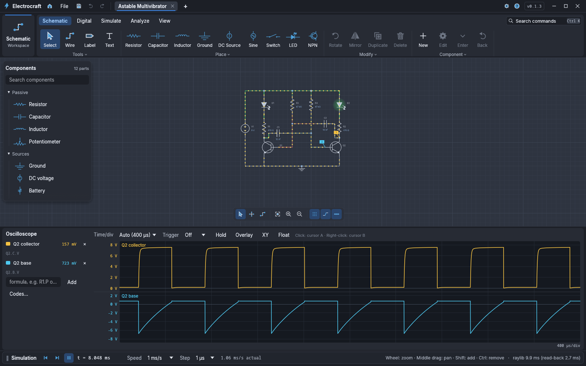

*Electrocraft 0.1.4: an astable multivibrator running live, with scope channels on Q2's collector and base (`Q2.C.V`, `Q2.B.V`). Wires are coloured by voltage, yellow dots show current, the LEDs glow in proportion to their current. Screenshots in this document are captured from the real application by `scripts/capture_screenshots.py`.*

## 1. Overview & goals

Electrocraft is a native Rust desktop app for drawing electronic schematics and simulating them live, in the spirit of iCircuit: you place parts, wire them, and see voltages, currents and waveforms update while you flip switches and turn knobs. On demand, the same circuit can be run through a slower, SPICE-grade analysis for accurate results.

**Goals**

- **Live interactive simulation:** the circuit runs continuously at a real-time or scaled pace. Edits and control changes (switches, potentiometers, sources) take effect immediately.
- **SPICE-grade analysis as a command:** DC operating point, transient, AC (frequency response) and parameter sweeps, run on request with tight tolerances. The results open in a plot window.
- **Programmable components:** every component, built-in or user-made, is defined through one contract. Users write their own components in JavaScript.
- **Model import:** components can be created from SPICE `.model` and `.subckt` files. A separate companion tool turns datasheet data into component definitions.
- **Mixed-signal:** analog and digital parts in the same schematic.

**Non-goals for v1**

- PCB layout, footprints, routing.
- RF and electromagnetic field simulation, transmission lines beyond a lossless ideal model.
- Thermal simulation (device temperature is a fixed parameter).
- Collaborative or cloud editing.

## 2. Decision log

The choices below are settled. The coding agent should treat them as constraints, not suggestions.

| # | Decision | Choice | Reason |
| --- | --- | --- | --- |
| D1 | Language | Rust (stable, 2021 edition or later) | Owner's choice. Performance and safety for the solver. |
| D2 | UI shell | egui (via eframe) for all panels, menus, dialogs, inspectors | SolidCraft, the look-and-feel reference (D10), is an egui application. Meshcraft has since moved its native shell to GPUI; Electrocraft stays on egui. |
| D3 | Schematic canvas rendering | Raylib 6 on its own thread with a hidden window, rendering off-screen into a render texture. The pixels are read back and uploaded into an egui texture shown as an image. | Same pattern as Meshcraft's `RaylibWorker`. Raylib has been artifact-free on the owner's machine. |
| D4 | GPU API | No WGPU anywhere, including egui's backend: use eframe's glow (OpenGL) backend | WGPU apps showed rendering artifacts on the owner's machine. |
| D5 | Simulation method | Modified Nodal Analysis (MNA), time-stepped, with companion models and Newton-Raphson. Digital parts run on an event layer coupled to the analog solver. | Industry standard (SPICE, iCircuit, Falstad). Handles both live and accurate modes. |
| D6 | Two simulation modes | **Interactive** (continuous, real-time, relaxed tolerances) and **Analysis** (commands: DC OP, transient, AC, sweeps; SPICE tolerances) | Owner wants both. Both use the same engine and component models with different settings. |
| D7 | Component contract | Components declare physics (pins, parameters, branch currents and charges as expressions of voltages). The engine derives stamps, derivatives and integration. | Users never touch solver internals. The solver can evolve without rewriting components. |
| D8 | User component language | JavaScript (ES2020) on the QuickJS engine, via the `rquickjs` crate | Owner's choice. Widely known, so users can write components without learning a new language. Scripts only build expressions; the hot loop runs native code, so script speed does not limit simulation speed. |
| D9 | Model sources | SPICE `.model` / `.subckt` import in the main app; datasheet-to-model conversion in a separate companion tool | Manufacturers publish SPICE models. Datasheets give parameters for known model families, not programs. |
| D10 | Look and feel | SolidCraft's visual language: custom title bar with document tabs, a ribbon with a workspace card, grouped icon buttons and command search, floating rounded panels over the canvas, a floating navigation toolbar, a transport bar along the bottom, and a blue Start screen (section 9.1) | Owner's choice. The Craft family of apps should feel like one product. |
| D11 | Canvas operation | Wirecraft's conventions: zoom at the pointer, middle-drag pan, left-to-right window and right-to-left crossing selection, Shift adds, Ctrl removes, a 3 px drag threshold, a placement shadow that follows the pointer, a right-click context menu with the part palette, Escape cancels (section 9.3) | Owner's choice. Same muscle memory across Wirecraft and Electrocraft. |
| D12 | Packaging | Meshcraft's release pipeline and artifact matrix, with AppImages named and described the way AppGlider prefers (section 13) | Owner's choice. AppGlider is how the owner installs and updates the Craft apps. |
| D13 | Name | Electrocraft. Crate prefix `ecs`, schematic extension `.ecs`, binary and window app id `electrocraft`, AppStream id `io.github.alfu32.electrocraft` | Resolves Q1. |
| D14 | Automation | Every user-facing action is a command with a stable string id and JSON arguments (`commands.rs`). Menus, ribbon, palette, `--commands` scripts and the coming MCP server all go through it (section 9.6) | The owner will publish an MCP server; Meshcraft uses the same single-registry pattern. |
| D15 | Scope | The oscilloscope is not a component. Its channels are formulas over codes: every net has a code (its label, or a stable `n<wire id>`), every part terminal has a voltage and a current (`R1.A.V`, `R1.A.I`, two-terminal parts also `R1.V`, `R1.I`), and part probes add their own (`D1.P`) (section 9.5) | Owner's choice: measuring must not change the schematic, and formulas cover power, differences and ratios. |
| D16 | Components in a schematic | Any component, built-in or custom, has a symbol with named ports and an implementation. A schematic can carry its own component prototypes, implemented by a nested or external schematic, or by inline or external JavaScript; any instance opens its prototype for editing (sections 5.5, 9.7) | Owner's choice: hierarchical design without leaving the editor. |

## 3. Architecture

The simulator is a headless library with no UI dependency. The app talks to it only through messages. That keeps the engine testable from the command line and lets the datasheet tool reuse it.

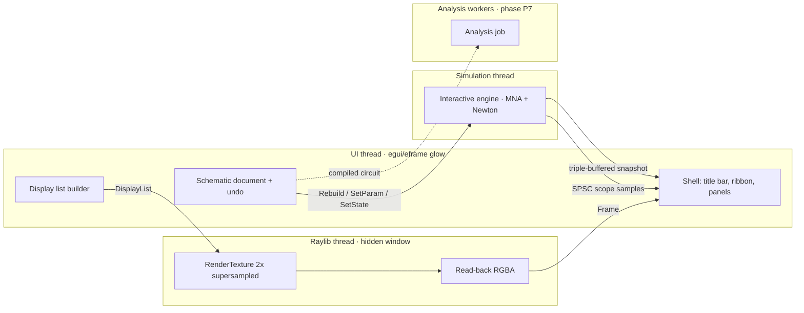

The UI thread sends edits and parameter changes to the simulation thread and reads back state snapshots and scope samples. Analysis commands run on worker threads, each with its own copy of the compiled circuit.

**Workspace crates**

| Crate | Kind | Responsibility | Depends on |
| --- | --- | --- | --- |
| `ecs-units` | lib | SI units, engineering notation parsing and formatting (`4k7`, `100n`, `2.2M`) | none |
| `ecs-expr` | lib | Expression graph, simplification, forward-mode autodiff, compilation to a flat instruction tape | ecs-units |
| `ecs-model` | lib | Component definition contract: pins, parameters, internal nodes, branches, behavioral and digital hooks | ecs-expr |
| `ecs-sim` | lib | Netlist compiler, MNA assembly, sparse LU, Newton-Raphson, integration, timestep control, event layer, all analyses | ecs-model |
| `ecs-lib` | lib | Built-in components, written in Rust against the same contract | ecs-model |
| `ecs-script` | lib | JavaScript host (QuickJS via `rquickjs`): loads `.js` component files into `ecs-model` definitions and parses `e` expression templates through `ecs-expr` | ecs-model |
| `ecs-spice` | lib | SPICE netlist, `.model` and `.subckt` parser and mapper | ecs-model, ecs-lib |
| `ecs-schematic` | lib | Schematic document: symbols, placement, wires, junctions, labels, hit testing, window selection, undo/redo, netlist extraction | ecs-units |
| `ecs-render` | lib | Raylib off-screen renderer of display lists (lines, polygons, circles, glows, text) on its own thread, with read-back | none (raylib) |
| `ecs-app` | bin | eframe application: shell, editor tools, scopes, plots, settings | all of the above |
| `ecs-cli` | bin | Headless runner: netlist in, CSV or JSON results out. Used for tests and benchmarks. | ecs-sim, ecs-lib, ecs-script, ecs-spice |
| `datasheet-tool` | bin | Companion app, later phase (section 8) | ecs-model, ecs-sim |

`ecs` stands for Electrocraft Simulator (D13). Hit testing lives in `ecs-schematic`, not `ecs-render`, so it is tested headless; the renderer only draws display lists the app builds.

**Threads and messages**

- **UI thread** owns the egui context and the schematic document. It builds a display list for the canvas each frame and submits it only when it differs from the last one.
- **Raylib thread** owns the Raylib context (a hidden 320×240 window) as in Meshcraft's `RaylibWorker`. It draws the newest display list into a render texture at twice the canvas size, downsamples on the GPU with bilinear filtering (2×2 supersampling, so wires and symbols are anti-aliased), reads the pixels back and hands the frame to the UI, which updates an egui texture. If Raylib cannot start, the same display list is painted with egui (the software canvas, also forced with `--software-canvas`).
- **Simulation thread** owns the compiled circuit and the interactive engine. It receives commands over a `crossbeam-channel`: `Rebuild(netlist)`, `SetParam`, `SetControl` (switch, potentiometer), `Run`, `Pause`, `SetSpeed`, `Reset`.
- **State out:** after each frame's worth of steps, the engine publishes a snapshot (node voltages, branch currents, digital states) through a lock-free triple buffer. The UI reads the newest one; old ones are dropped.
- **Samples out:** probed signals stream through a single-producer, single-consumer ring buffer per scope so no sample is lost between frames.
- **Analysis workers** come from a small pool. Each job gets a clone of the compiled circuit, reports progress, can be cancelled, and returns a result set (named vectors over time or frequency).
- **Topology edits** (adding a part, moving a wire) trigger a full recompile on the simulation thread. Parameter edits update values in place without recompiling.

## 4. Simulation engine

One engine serves both modes. The circuit is a system of nonlinear differential equations, solved one time step at a time with Newton-Raphson. The modes differ only in tolerances, step control and pacing (4.8).

### 4.1 Formulation

The unknown vector x holds every node voltage (ground is node 0 and excluded) plus one current for each branch that needs one: voltage sources, inductors, controlled voltage sources, and any component branch declared as a voltage-defined branch.

Every component contributes to a residual in charge-oriented form: a resistive part i(x, t) and a reactive part q(x), its stored charge or flux. Kirchhoff's current law at every node, plus each branch equation, gives:

```latex
F(x) = i(x, t) + \frac{d}{dt} q(x) = 0
```

Newton-Raphson solves each step by repeatedly solving the linear system below, where α comes from the integration method (4.2):

```latex
\left( \frac{\partial i}{\partial x} + \alpha \frac{\partial q}{\partial x} \right) \Delta x = -F(x)
```

The engine computes i, q and both Jacobians from each component's expressions using automatic differentiation (section 5). Components never write matrix stamps by hand. The charge form conserves charge exactly, which matters for switched-capacitor and nonlinear capacitance models.

### 4.2 Time integration

- **Backward Euler:** first step, the step after any breakpoint (switch flip, source edge, digital transition), and as a fallback after failed steps. Very stable, damps ringing.
- **Trapezoidal:** default otherwise. Second order, accurate for oscillators and filters.
- **Gear-2 (BDF2):** optional in Analysis mode, for circuits where trapezoidal produces numerical ringing.

The integrator keeps the history of q per component. A component never sees the integration method.

### 4.3 Nonlinear solving

- **Convergence test:** each node voltage must satisfy |Δv| < reltol·|v| + vntol, and each branch current |Δi| < reltol·|i| + abstol. Defaults: reltol 1e-3, vntol 1 µV, abstol 1 pA. As in SPICE, a **residual test** also accepts an iterate whose KCL error at every node is within reltol of the sum of the device currents meeting there (scaled from the step's converged starting point, so an overshooting iterate cannot loosen its own test). Without it, regenerative edges (multivibrators, latches) stall: the Jacobian is nearly singular along a common-mode direction that carries no current. Conversely, an update that only just passes the voltage test (more than a tenth of its tolerance) is accepted only once the new point's own KCL balances: far out on an exponential, Newton walks about one vt per step, which fits reltol·|v| at large voltages long before the currents agree (a 100 V breakdown "converged" at the wrong voltage with 10²³ A before this check; SPICE's device-current test guards the same case). Quadratically converged steps skip the extra evaluation.
- **Limiting:** components can declare limiting on a controlling voltage (the SPICE `pnjlim` style for junctions, `fetlim` for MOS gates). The engine applies it between iterations to stop exponentials from overflowing.
- **Gmin:** a tiny conductance (default 1e-12 S) across every nonlinear junction and from every node to ground, so no node floats.
- **DC operating point fallbacks:** plain Newton first; then gmin stepping (start at 1e-3 S, shrink to the default); then source stepping (ramp all independent sources from 0 to 100%). Report which method succeeded.

### 4.4 Linear solver

- The matrix sparsity pattern depends only on topology. The compiler computes it, chooses a fill-reducing ordering and does the symbolic factorization once per topology. Each Newton iteration only refactors numerically.
- Use `faer` for sparse LU. Hide it behind a `LinearSolver` trait so a dense LU (faster for small circuits, under about 50 unknowns) can be swapped in. The agent benchmarks both and picks the switch-over size. *Status:* the trait and the dense LU (partial pivoting) exist; `faer` and the benchmark are still to do.
- **Linear fast path:** if a circuit has no nonlinear components and the step size is fixed, the matrix never changes. Factor once and reuse the factors for every step until a switch or parameter change. Most beginner circuits hit this path, so live mode is very fast for them. *Implemented generically:* tapes report whether every output is affine in the unknowns; a linear circuit takes one Newton iteration per step, and the LU reuses its factors whenever the assembled matrix is bit-identical to the previous one (`rc_charge_and_factor_reuse` checks two factorizations for 2000 steps).
- Analysis mode AC uses the same pattern with complex numbers (`faer` supports complex LU).

### 4.5 Interactive mode

The goal is a responsive, believable picture, not the last digit of accuracy.

- **Pacing:** the user sets a simulation speed (simulated time per real second) and a nominal time step. Each UI frame, the engine advances simulated time by speed × frame time, within a CPU budget (default 60% of a frame). If it cannot keep up, it slows down and the status bar shows the actual rate.
- **Step control:** fixed nominal step, reduced automatically around breakpoints and when Newton fails: halve down to h/2^20 (regenerative edges need steps short enough for junction charge to dominate), and double again after every two successes. No truncation-error control.
- **Failure is never fatal:** after the step floor is reached, the engine accepts the last Newton iterate if it is finite and of the same order as the starting state (otherwise it keeps the previous state), flags the nonlinear components with a "convergence trouble" marker, and keeps running. Markers clear after 5000 clean steps.
- **Live controls:** switches, potentiometers, and source values change between steps and insert a breakpoint.
- **Reset:** recompute the DC operating point and restart time at zero.

### 4.6 Analysis mode commands

Analysis commands are invoked from a menu or the command palette. Each runs on a worker and opens its result in a plot window.

| Command | SPICE equivalent | What it does | Phase |
| --- | --- | --- | --- |
| DC operating point | `.op` | Solve with capacitors open and inductors shorted. Annotate every node and part on the schematic. | v1 |
| DC sweep | `.dc` | Sweep one or two sources or parameters, solve the operating point at each value | v1 |
| Transient | `.tran` | Variable-step transient with truncation-error control, breakpoints, start from OP or user initial conditions | v1 |
| AC small-signal | `.ac` | Linearize at the operating point, sweep frequency (linear, per decade, per octave). Bode plot. | v1 |
| Parameter step | `.step` | Repeat any analysis over a list or range of parameter values, in parallel | v1 |
| FFT | none | Spectrum of any transient result, computed in the plot window | v1 |
| Noise | `.noise` | Output and input-referred noise density | later |
| Monte Carlo and temperature | `.mc`, `.temp` | Tolerance and temperature spreads | later |

AC analysis needs nothing extra from components: the small-signal model is the Jacobians ∂i/∂x and ∂q/∂x at the operating point, which autodiff already provides.

*Implemented (`ecs-sim::analysis`):* operating point (also as a table result); DC sweep of any instance parameter (live parameters change in place with a warm start, others recompile per point); transient with error-controlled step choice: the step adapts so the difference between the solution and a linear predictor stays near reltol, landing on digital events, capped by the maximum step (steps are not rejected yet); AC small-signal on a log frequency sweep, excited by each source's `AC` parameter (the sine source defaults to 1 V), solved with a dense complex LU; parameter step running each point on its own thread; FFT (resampling to a power of two, Hann window, amplitude-correct). Results are named vectors with CSV export. Gear-2, user initial conditions, linear and per-octave sweeps, and two-source DC sweeps are still to do.

### 4.7 Digital event layer

- Each digital pin belongs to a **logic family** (e.g. 5 V CMOS, 3.3 V CMOS, TTL) that defines input thresholds, output high and low voltages, output resistance, and rise and fall times.
- **Inputs** read the analog node voltage and convert it to 0, 1 or X (between thresholds), with optional hysteresis.
- **Outputs** drive the analog node through a Thevenin equivalent (voltage and resistance). A change ramps over the family's rise or fall time rather than jumping, which keeps Newton stable.
- **Events:** a digital component reacts to input changes by scheduling output changes after its propagation delay on a time-ordered queue. The analog stepper always lands exactly on queued event times.
- **Later optimization:** nets with only digital pins can be resolved purely in the event domain without analog nodes.

*Implemented:* families `cmos5` (default), `cmos33`, `ttl`, and `rail:<P>:<N>` whose levels follow two pins (the 555's output). A component's `family` enum parameter selects it. The compiler synthesizes a Thevenin branch per digital output whose voltage ramps linearly over the rise time between levels held in live state slots, and an input resistance per digital input. Inputs use the family thresholds with hysteresis (a level in between keeps the previous level). Events live on a min-heap; the stepper shortens any step to land on the next event, applies due drives with a breakpoint, re-reads inputs and runs `on_inputs`, following zero-delay chains a bounded number of times. **Watches** are boolean expressions a definition declares (a 555's `V(THR) > 2/3 V(VCC)`), read like inputs. Tri-state outputs scale their driver resistance by a state (`__oe_<pin>`). At reset, digital parts settle with `on_start` and instant drives; settling never reports clock edges, so power-up does not count. Behaviors also receive user controls (`on_control`), so a logic toggle drives its output directly.

### 4.8 Mode settings

| Setting | Interactive | Analysis |
| --- | --- | --- |
| reltol | 1e-2 | 1e-3 (user-settable) |
| Max Newton iterations per step | 20 | 100 |
| Step control | Fixed nominal, halving on failure, landing on digital events | Error-controlled step choice, maximum step, landing on digital events |
| Integration | θ-method with θ = 0.6 (damped trapezoidal), Euler at breakpoints | Trapezoidal (θ = 0.5); Gear-2 still to do |
| On non-convergence | Accept step, flag component, continue | Abort with a diagnostic naming the nodes that failed |
| Pacing | Real time × speed factor | As fast as possible |
| Output | Snapshots and probed signals only | Every node and branch current, every accepted step |

Why θ = 0.6 in interactive mode: trapezoidal integration is A-stable but not L-stable, so on a stiff edge a fast mode is multiplied by −1 every step and rings instead of decaying. The astable sample showed its collector spiking to 16 V on a 9 V supply. The θ-method multiplies such a mode by −(1−θ)/θ, −0.67 at θ = 0.6, so it dies out within a few steps, and the collector stays within 0 to 7.5 V. Analysis mode keeps exact trapezoidal for accuracy.

## 5. Component model contract

A component is data, not solver code: it declares its pins, parameters and branch equations as expressions, and the engine does everything else. Built-in Rust components, JavaScript components, SPICE imports and subcircuits all produce the same `ComponentDef`.

### 5.1 What a definition contains

| Part | Contents | Example |
| --- | --- | --- |
| Identity | Stable id, display name, category, version, author | `core.diode`, "Diode", Semiconductors |
| Pins | Name, kind: analog, or digital with a logic family | `A`, `K` |
| Parameters | Name, unit, default, range, type (real, integer, enum, bool, file), and a **live** flag for values changeable while running | `Is = 1e-14 A`, `N = 1`, `Rs = 0 Ω` |
| Internal nodes | Extra nodes private to the component | Node between Rs and the junction |
| Current branches | Between two nodes: current i = f(…) and charge q = g(…) | Junction current and depletion charge |
| Voltage branches | Between two nodes: voltage v = f(…). Adds a branch-current unknown. | Voltage source, inductor (as flux) |
| State variables | Discrete values changed only by events, read by expressions | Switch position, flip-flop Q |
| Behavior hooks | Callbacks on input change, timers and user controls. They may change state and schedule events. | Clock edge, button press |
| Breakpoints | Times where the component's sources are discontinuous | Edges of a pulse source |
| Limiting | Which controlling voltages use junction or FET limiting | `pn` limiting on V(A, K) |
| Probes | Named quantities shown in the inspector and plottable | Power dissipated, junction current |
| Symbol | Reference to a symbol file (drawing and pin positions), separate from the electrical model | `symbols/diode.sym` |

### 5.2 Expressions

Expressions are built as a graph, never as strings evaluated at run time. Leaves and operations:

- **Leaves:** constants, parameters, node voltages V(n) or V(a, b), branch currents I(branch), time t, temperature, state variables.
- **Arithmetic:** + − × ÷, pow (`^`, `**`), neg, abs, min, max, floor.
- **Functions:** exp, ln, log10, sqrt, sin, cos, tan, atan, tanh, sinh, cosh.
- **Safe variants:** `limexp(x)`, exponential that continues linearly beyond x = 80 so junctions cannot overflow; `safe_div`, `safe_sqrt`.
- **Conditionals:** `select(cond, a, b)` (also `cond ? a : b`) with comparisons `< <= > >= == !=` and logic `&& || !`. Conditionals on voltages are allowed but create kinks; the library provides `smoothstep` and `smooth_abs` and documentation recommends them.
- **Numbers** may use engineering notation (`4k7`, `100n`, `2.2M`); `pi` is a constant.

**Compilation pipeline** (in `ecs-expr`): constant folding (non-live parameters are folded at compile time), common subexpression elimination, then forward-mode automatic differentiation with respect to every unknown the expression reads. The result is a flat instruction tape per component that computes values and all partial derivatives in one pass. A tape interpreter in Rust runs it in the hot loop. A JIT (for example Cranelift) is out of scope but the tape format must not rule it out.

### 5.3 Rust shape of the contract

```rust
pub struct ComponentDef {
    pub id: ComponentId,
    pub meta: Meta,                       // name, category, version, docs
    pub pins: Vec<PinDef>,
    pub params: Vec<ParamDef>,
    pub internal_nodes: Vec<NodeName>,
    pub branches: Vec<BranchDef>,         // current or voltage branches
    pub states: Vec<StateDef>,
    pub limits: Vec<LimitDef>,
    pub probes: Vec<ProbeDef>,
    pub behavior: Option<Box<dyn Behavior>>, // events, timers, controls
    pub breakpoints: Option<Expr>,        // or a callback; see 5.4
    pub symbol: SymbolRef,
    pub kind: DefKind,                    // Primitive or Subcircuit(netlist)
}

pub enum BranchDef {
    Current { a: NodeRef, b: NodeRef, i: Expr, q: Option<Expr> },
    Voltage { a: NodeRef, b: NodeRef, v: Expr, flux: Option<Expr> },
}

pub trait Behavior: Send {
    fn on_inputs(&mut self, ctx: &mut EventCtx);   // digital inputs changed
    fn on_timer(&mut self, ctx: &mut EventCtx, tag: u32);
    fn on_control(&mut self, ctx: &mut EventCtx, control: &ControlEvent);
}
```

`EventCtx` lets a behavior read digital input levels, node voltages and state; write state; schedule digital outputs and timers. It cannot add nodes or change expressions. Structural changes require a recompile.

*Implementation notes (0.1.0):* behaviors take `&self` and keep per-instance data in `EventCtx::state`, so one `Arc<dyn Behavior>` serves every instance. Definitions also declare `controls` (`Toggle`, `Momentary`, `Slider`) and named subexpressions `lets` (the Rust side of `c.let`). Switch positions and the potentiometer wiper need no behavior code: controls set state variables or live parameters directly.

### 5.4 Rules the engine enforces

- Every expression must be finite for any input. The engine checks for NaN and infinity after each evaluation and reports the component by name.
- Voltage branches in a loop with no resistance (two ideal sources in parallel) and nodes with no DC path to ground are detected at compile time and reported, not left to the solver.
- Subcircuits flatten at compile time. Their internal nodes are namespaced (`X1.Q3.b`) so probes and error messages stay readable.
- A `ComponentDef` is immutable after loading. Live parameters are the only values that change during a run.

### 5.5 Components defined in a schematic (D16)

A schematic's `components` list holds prototypes with ids `local.<name>`. Each has a name, category, reference prefix, description, its own **symbol** (drawing plus named pins on the 20-unit grid; the pins are the ports), **parameters** (name, default, unit, description) and an **implementation**:

| Implementation | How it compiles |
| --- | --- |
| `schematic` | A nested schematic stored inline. Net labels named like the symbol's pins are the ports; ground inside is the global ground. Inner part values written `{expression}` use the component's parameters (`{R}`, `{2 * gain}`) and are evaluated per instance when the subcircuit flattens. Becomes a `DefKind::Subcircuit`. |
| `external_schematic` | The same, read from an `.ecs` file relative to the schematic's folder. |
| `script` | JavaScript source (section 6) stored inline; its pins must be on the symbol. |
| `external_script` | A `.js` file relative to the schematic's folder. |

Prototypes compile into the catalog whenever they change (`crates/ecs-app/src/components.rs`), in dependency order so one may use another. A library part can be copied into an editable prototype: definitions made of expressions convert to equivalent JavaScript (expressions print back to source that parses to the same tree); Rust-behaviour parts and subcircuits start from a template instead.

## 6. Scripting with JavaScript

Users write components as JavaScript (ES2020) files, run by the QuickJS engine through the `rquickjs` crate. A script runs once at load time to build a `ComponentDef`. After that, only its behavior hooks run, and only on events. JavaScript never runs inside the Newton loop, so script speed does not limit simulation speed.

**Why QuickJS.** It is small (under 1 MB), embeds cleanly, and supports memory limits and an interrupt handler for runaway code. V8 (through `deno_core`) is far larger and harder to build. Boa, a pure-Rust engine, can be reconsidered later; the scripting front end is thin, so swapping engines does not touch the simulator.

**Equations use a tagged template.** JavaScript has no operator overloading, so `a * b` cannot build an expression graph. Equations are written as `` e`Is * (limexp(V(A, K) / (N * vt)) - 1)` ``. The `e` tag parses the text with the same expression parser (`ecs-expr`) used for arbitrary-expression sources in the inspector, so there is one expression language everywhere. `${}` inserts an expression object or a number. Parse errors report file, line and column.

**TypeScript support.** The app ships a `.d.ts` file describing the API, so editors such as VS Code autocomplete and type-check component files. Users may write TypeScript and compile it themselves; v1 loads only JavaScript.

### 6.1 Script API

- `export default component({ ... })` returns a definition. Fields mirror section 5.1. Files are ES modules; `import` resolves only inside the component's own package.
- `param(default, unit, description, opts)` declares a parameter. `opts` holds range, enum values and `live: true`.
- Pins: a plain name is analog; `digital(family)` and `digitalOut(family)` declare digital pins.
- Inside `equations(c) { ... }`:
  - In `e` templates, names resolve to parameters, `V(a)`, `V(a, b)`, `I(branch)`, `t`, `temp`, `vt` (thermal voltage at the simulation temperature), state variables, names declared with `c.let`, and the functions of 5.2.
  - `c.current(a, b, i, q)` and `c.voltage(a, b, v, flux)` add branches; `c.node(name)` adds an internal node.
  - `c.let(name, expr)` names a subexpression for reuse in later templates; `c.limit("pn" | "fet", expr)`; `c.probe(name, expr, unit)`.
  - **Equations as plain functions.** Wherever an expression is expected, a JavaScript function works too: `c.current("A", "K", ({ Is, N }) => Is * (limexp(V("A", "K") / (N * vt)) - 1))`. The function is compiled, not run (`crates/ecs-script/src/jsfn.rs`): its source becomes one expression that the engine differentiates and evaluates natively, exactly like a template, but the code is ordinary JavaScript that editors highlight and check. Parameters of the function name component variables (parameters, states, `c.let` names, `vt`, `temp`, `t`), usually destructured. Inside: `const`/`let` and reassignment, `if`/`else` and `return` (folded into `select`, each branch continuing with the statements after the `if`), `?:`, arithmetic, `**`, `%`, comparisons, `&&`, `||`, `!`, `Math.*` (mapped to the expression functions), the expression functions themselves (`limexp`, `select`, `smoothstep`, `safe_div`…), `V("A", "K")` and `I("L")` with names in quotes, and calls to **helper functions declared at the top of the file**, which are inlined with their arguments. Loops, recursion, objects and other strings are rejected with the file line. The prelude also defines the expression functions as numeric JavaScript so the same helpers can run in hooks; `V` and `I` only have values in equations.
- Hooks: `onInputs(ctx)`, `onTimer(ctx, tag)`, `onControl(ctx, event)`. `ctx` offers `level(pin)` (0, 1 or "X"), `rising(pin)`, `falling(pin)`, `voltage(pin)`, `state`, `param`, `drive(pin, level, delay)`, `timer(delay, tag)`.

### 6.2 Examples

A diode with junction capacitance:

```javascript
export default component({
  id: "user.simple_diode",
  name: "Simple diode",
  category: "Semiconductors",
  symbol: "diode",
  pins: ["A", "K"],
  params: {
    Is: param(1e-14, "A", "Saturation current"),
    N:  param(1.0,   "",  "Emission coefficient"),
    Cj: param(2e-12, "F", "Junction capacitance"),
  },
  equations(c) {
    c.let("Id", e`Is * (limexp(V(A, K) / (N * vt)) - 1)`);
    c.current("A", "K", e`Id`, e`Cj * V(A, K)`);
    c.limit("pn", e`V(A, K)`);
    c.probe("P", e`V(A, K) * Id`, "W");
  },
});
```

The same diode written with functions (`crates/ecs-script/components/function_diode.js`, shipped as a reference), adding a depletion charge continued linearly above Fc·Vj and a smooth breakdown:

```javascript
/** Shockley junction current; limexp keeps large forward bias finite. */
function shockley(vd, Is, N) {
  return Is * (limexp(vd / (N * vt)) - 1);
}

/** Depletion charge, continued linearly above Fc·Vj so it never blows up. */
function depletionCharge(vd, Cj, Vj, M) {
  const fc = 0.5 * Vj;
  const v = Math.min(vd, fc);
  const q = (Cj * Vj) / (1 - M) * (1 - (1 - v / Vj) ** (1 - M));
  if (vd <= fc) {
    return q;
  }
  const slope = Cj * (1 - fc / Vj) ** -M;
  return q + slope * (vd - fc);
}

/** Reverse breakdown: smooth everywhere, so Newton always has a slope. */
function breakdown(vd, IBV, BV) {
  return -IBV * limexp(-(vd + BV) / vt);
}

export default component({
  id: "user.function_diode",
  name: "Diode (functions)",
  pins: ["A", "K"],
  params: {
    Is: param(1e-14, "A", "Saturation current"), N: param(1.0),
    Cj: param(2e-12, "F"), Vj: param(0.7, "V"), M: param(0.5),
    BV: param(100, "V"), IBV: param(1e-10, "A"),
  },
  equations(c) {
    c.let("Id", ({ Is, N, IBV, BV }) => shockley(V("A", "K"), Is, N) + breakdown(V("A", "K"), IBV, BV));
    c.current("A", "K", ({ Id }) => Id, ({ Cj, Vj, M }) => depletionCharge(V("A", "K"), Cj, Vj, M));
    c.limit("pn", () => V("A", "K"));
    c.probe("P", ({ Id }) => V("A", "K") * Id, "W");
  },
});
```

A test checks that it matches the template diode at every bias, clamps at breakdown and runs a fast transient. New components in the component editor start from a function-style template.

A D flip-flop, purely behavioral:

```javascript
export default component({
  id: "user.dff",
  name: "D flip-flop",
  category: "Digital",
  symbol: "dff",
  pins: { D: digital(), CLK: digital(), Q: digitalOut(), QN: digitalOut() },
  params: { tpd: param(10e-9, "s", "Propagation delay") },
  states: { q: 0 },
  onInputs(ctx) {
    if (ctx.rising("CLK")) {
      const d = ctx.level("D");
      ctx.state.q = d;
      ctx.drive("Q", d, ctx.param.tpd);
      ctx.drive("QN", d === "X" ? "X" : 1 - d, ctx.param.tpd);
    }
  },
});
```

### 6.3 Sandbox and lifecycle

- **Available:** the ECMAScript standard library and the component API only. No file system, network, process, `setTimeout`, or Node or browser APIs. `eval` and the `Function` constructor are disabled.
- **Limits:** a memory cap per QuickJS runtime and an interrupt handler that enforces a time budget per hook call. A hook that exceeds its budget is stopped, and the component is flagged with the error.
- **Threads:** each simulation thread and each analysis worker owns its own QuickJS runtime. JavaScript values never cross threads.
- **Hot reload:** the app watches user component folders. Saving a `.js` file reloads the definition and recompiles open circuits that use it. Load errors appear in the problems panel with file and line.
- **Built-ins in JavaScript:** a few built-in components are also shipped as JavaScript (for example the flip-flop above) and serve as reference examples for users.

*Implemented (`ecs-script`, QuickJS through `rquickjs` 0.14):* the API of 6.1 is a JavaScript prelude; the script runs once and hands a JSON description to Rust, which parses every `e` template with `ecs_expr::parse`, so templates and the inspector share one parser. Each template records its own `file:line:column` from the stack, so parse errors point at the template. Module files are loaded as scripts with the `export default` rewritten to a global; `import` is not available yet. The sandbox removes `eval` and the `Function`, async, generator and async generator constructors, adds no host modules (no `std`, `os`, `require`, `fetch`, timers), caps memory at 64 MB and stops any load or hook after 250 ms through the interrupt handler. Hooks run in a QuickJS runtime owned by the calling thread (a thread-local per script), exchanging JSON with the engine; a hook error is kept and shown in the problems list through `Behavior::diagnostics`. Hot reload polls `~/.config/electrocraft/components/*.js` once a second; **File ▸ User Components Folder** creates it, writes `electrocraft.d.ts` and example copies, and opens it. The two 6.2 examples ship embedded and appear in the Components panel.

## 7. Built-in component library (v1)

v1 ships about 60 components, enough for typical hobby and education circuits. Each is defined against section 5 and has a test circuit with a known answer (section 11).

| Category | Components | Model notes |
| --- | --- | --- |
| Passive | Resistor, capacitor, inductor, potentiometer, transformer, fuse | Capacitor and inductor with optional series resistance. Potentiometer wiper is a live parameter. Transformer as coupled inductors with coupling k. Fuse opens above its I²t rating. |
| Sources | Ground, DC voltage, DC current, battery, sine, pulse, piecewise linear, function generator, rail label | Battery has internal resistance. Pulse and PWL sources declare breakpoints. Function generator: sine, square, triangle, sawtooth. |
| Controlled and behavioral sources | VCVS, VCCS, CCVS, CCCS, arbitrary-expression voltage and current source | The arbitrary source takes a user expression in the 5.2 language, typed in the inspector |
| Switches and inputs | SPST, SPDT, push button, relay, voltage-controlled switch | Relay: coil inductance and resistance, pull-in and drop-out currents, contact bounce off by default |
| Diodes | Diode, Zener, LED, Schottky | SPICE level-1 diode with Rs, Cj, breakdown. LED glows on the canvas in proportion to its current. |
| Transistors | NPN, PNP, N-MOSFET, P-MOSFET, N-JFET, P-JFET | BJT: Gummel-Poon subset (Is, Bf, Br, Vaf, Rb, Rc, Re, Cje, Cjc, Tf). MOSFET: level 1 (Shichman-Hodges) with Cgs, Cgd, body diode. JFET: SPICE JFET model. |
| Analog ICs | Ideal op-amp, op-amp macromodel, comparator, 555 timer, linear regulator | Macromodel: gain-bandwidth, slew rate, output swing to rails, current limit. 555 and regulator are behavioral. |
| Digital | AND, OR, NAND, NOR, XOR, XNOR, NOT, buffer, tri-state buffer, D, JK and T flip-flops, counter, shift register, multiplexer, BCD to 7-segment decoder | Families: 5 V CMOS, 3.3 V CMOS, TTL |
| Digital I/O | Logic toggle, clock, logic probe | Logic toggle is clickable while running |
| Indicators | Lamp, 7-segment display, LED bar | Lamp is a temperature-dependent resistor; brightness drawn on the canvas |
| Instruments | Voltmeter, ammeter, probe, scope channel | Ideal: infinite or zero impedance, no effect on the circuit |

Later: MOSFET level 3 and BSIM, motors, speakers with audio output, microcontroller blocks, optocouplers, SCR and TRIAC.

*Implemented (55 definitions: 53 in `ecs-lib` plus the two JavaScript references):* ground; resistor, capacitor (with leakage), inductor (with series resistance), potentiometer (live wiper), lamp; DC voltage, battery, DC current, sine, function generator (sine, square, triangle, sawtooth), all with an `AC` magnitude for AC analysis; diode, Zener, Schottky, LED; SPST, push button, SPDT; NPN and PNP (Ebers-Moll transport with `Nf`, Early effect and junction capacitances); N- and P-MOSFET (level 1); N- and P-JFET (Shichman-Hodges with gate diodes); op-amp, comparator; behavioural CMOS 555 (7555-like output, watches for trigger, threshold and reset, a discharge switch and an internal divider); VCVS, VCCS, CCVS, CCCS; AND, OR, NAND, NOR, XOR, XNOR, NOT, buffer, tri-state buffer, D, JK and T flip-flops, 4-bit counter, 4-bit shift register, 2:1 multiplexer, BCD to 7-segment decoder (hex digits included); logic toggle, clock, logic probe; 7-segment display; voltmeter, ammeter. The oscilloscope is not a part (D15, section 9.5). Not yet: transformer, fuse, PWL and pulse with breakpoints, arbitrary-expression sources (need string parameters), relay, voltage-controlled switch, op-amp macromodel, regulator, LED bar.

## 8. Model import

There are two routes from a real part to a component. SPICE import is in the main app and comes first, because most manufacturers publish SPICE models. Datasheet conversion is a separate companion tool built later.

### 8.1 SPICE import (`ecs-spice`)

- **Input:** `.lib`, `.mod`, `.sub`, `.cir` files, or text pasted into a dialog.
- **Supported cards:** `.model` for D, NPN, PNP, NMOS and PMOS (level 1), NJF and PJF; `.subckt` built from R, C, L, V, I, E, F, G, H, D, Q, M, J, X and behavioral B sources (the expression subset that maps to 5.2); `.param`, `.include`, `.lib`; SPICE engineering suffixes (`meg`, `u`, `n`, `p`).
- **Mapping:** each `.model` becomes a built-in component with its parameters filled in. Each `.subckt` becomes a subcircuit component. Models for unsupported levels map to the nearest supported level with a warning listing ignored parameters.
- **Symbols:** the import dialog lets the user pick a standard symbol and map pins to subcircuit ports. Without a choice, a rectangle symbol with labeled pins is generated.
- **Output:** a component package (section 10) saved to the user library, plus an import report listing anything ignored or approximated.
- **Dialects:** plain SPICE3 and the common LTspice and PSpice extensions. Encrypted vendor models are not supported.

*Implemented:* continuation lines, `*`, `;` and `$` comments, `.param` with `{expr}` evaluated by the 5.2 language, `.include` and `.lib <file> <section>`, the netlist title line, and `.op`, `.tran`, `.dc` and `.ac dec` analysis cards (the CLI runs them all). Each `.model` copies the matching built-in with its parameters filled in (`IS N BV IBV CJO` for diodes; `IS NF BF BR VAF CJE CJC` for BJTs; `KP VTO LAMBDA` and instance `W/L` for MOSFETs; `BETA VTO LAMBDA IS` for JFETs) and lists the rest in the report. Each `.subckt` becomes a subcircuit definition that the compiler flattens (`X1.Q3`), nested to any depth. F and H sources and B sources read other elements' currents through `I(Vx)`, resolved to the sibling first; B sources' node voltages become extra pins. Coupled inductors (`K`) are reported and ignored. **Import dialog** (Analyze ▸ Import, or File): paste or open, review components and the report, choose a symbol per subcircuit with a port-to-pin mapping (three-port op-amp-like subcircuits default to the op-amp symbol), and **Add to library**: a package folder `~/.config/electrocraft/packages/<name>/` with `package.json` and `models/<original file>` that loads at every start. **Export** writes a SPICE netlist (with `.model` cards for diodes, transistors and JFETs) that imports back to the same operating point.

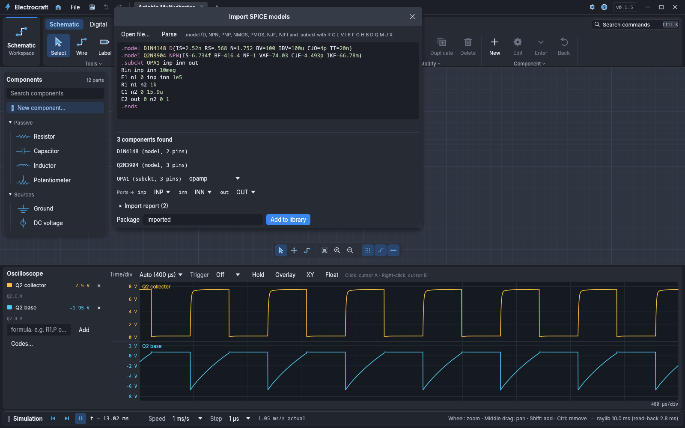

### 8.2 Datasheet tool (`datasheet-tool`, binary `electrocraft-datasheet`)

A datasheet gives numbers and curves, not equations. The tool fits parameters of a known model family to those numbers and writes a JavaScript component.

1. Pick a model family: diode, Zener, LED, BJT, MOSFET, op-amp macromodel, regulator.
2. Enter datasheet points in a form for that family. Examples: forward voltage at given currents; hFE versus collector current; Ciss, Coss and Crss; gain-bandwidth and slew rate.
3. Optionally digitize curves: load a screenshot of a datasheet graph, calibrate the two axes (linear or log), click points along a curve.
4. Fit: Levenberg-Marquardt least squares, evaluating the model through `ecs-sim` test benches (for example a swept current source into the diode).
5. Review: overlay plots of datasheet points against the fitted model, with error per point.
6. Export a JavaScript component file and a fit report into a component package.

*Implemented:* families diode, LED, Zener (forward points plus Vz at Iz), NPN (hFE versus Ic at a Vce, and Vbe versus Ic) and N-MOSFET (Id versus Vgs at a Vds); op-amp macromodel and regulator are still to do. Each point is simulated on a test bench with the built-in model (a current source into the diode; Vce and base-current sources for hFE; a bisected base voltage for Vbe; gate and drain sources for the MOSFET). Levenberg-Marquardt fits the family's parameters (log space for scale parameters) from closed-form starting values. The digitizer loads a PNG or JPEG, takes two calibration clicks per axis with typed values (linear or log axes), then adds a point per click to the selected series. Review overlays the points on the model curve, with the error of each point in the table. Export writes `<part>.js` (the 6.1 API with the fitted defaults) and `<part>.fit.md` (parameters, per-point errors and the equivalent SPICE `.model`) into the user components folder by default, where Electrocraft hot-reloads it. The app starts the tool from Analyze ▸ Datasheet Fit and from the desktop action. `--example diode|npn` loads the datasheet typicals used by the tests.

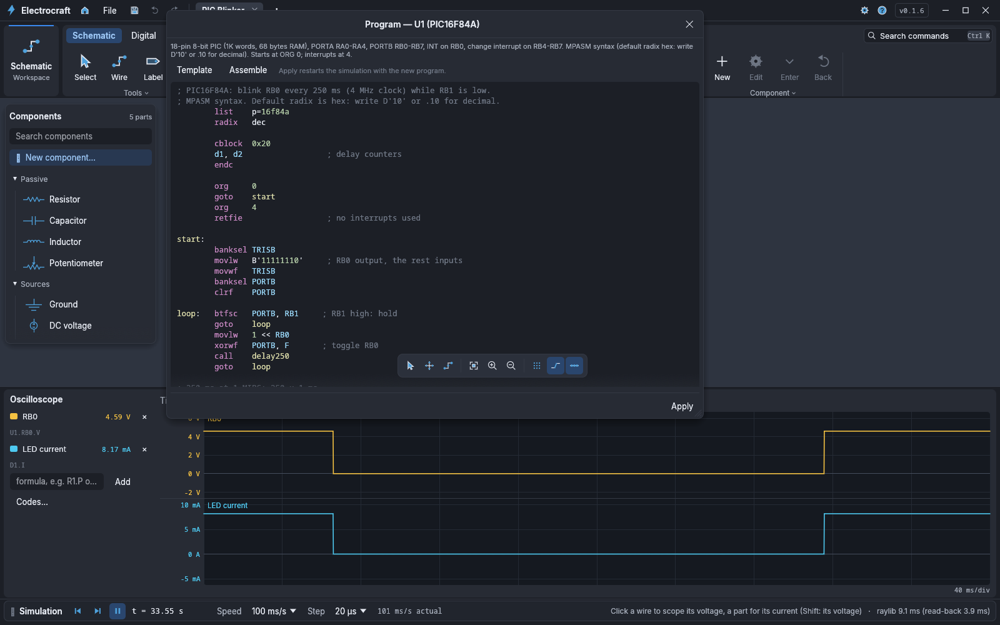

## 9. Editor & UI

egui owns every widget, panel and input event. Raylib only draws the schematic into an off-screen texture that egui shows as an image. Editing logic lives in `ecs-schematic` and `ecs-app`, never in the renderer.

### 9.1 Window layout (SolidCraft visual language, D10)

The shell copies SolidCraft's structure and palette so the Craft apps feel like one product. For comparison, the SolidCraft 0.30.1 references are in `docs/references/solidcraft/`:

| SolidCraft reference | Electrocraft |
| --- | --- |
| 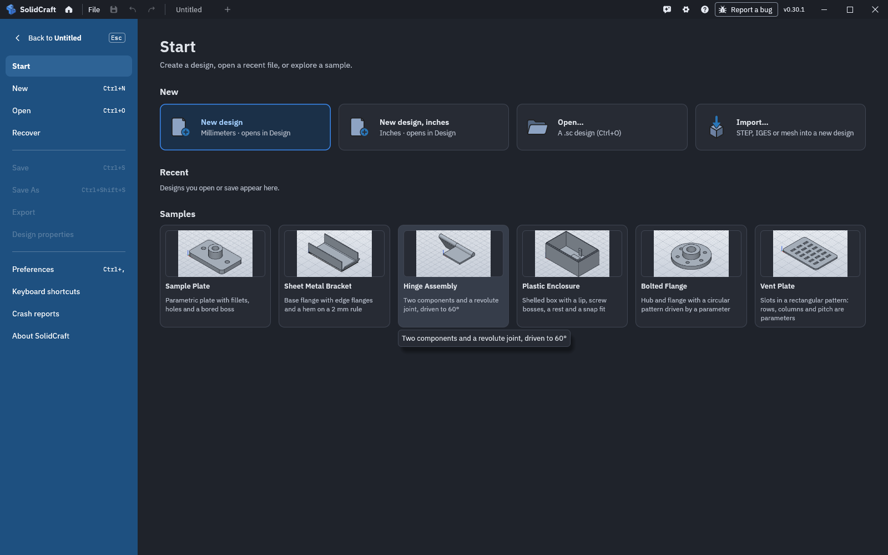 | 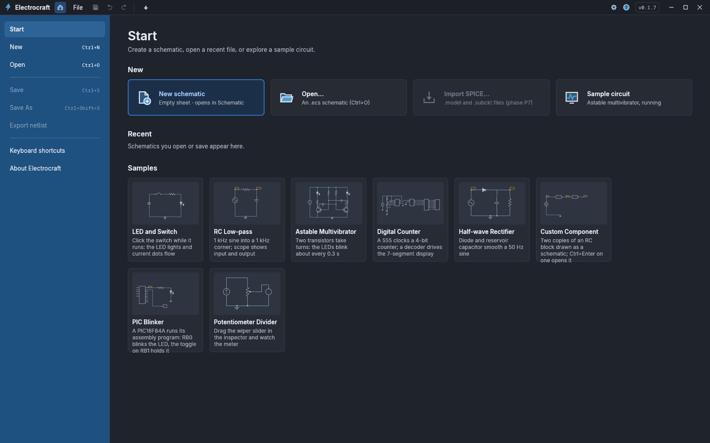 |
| 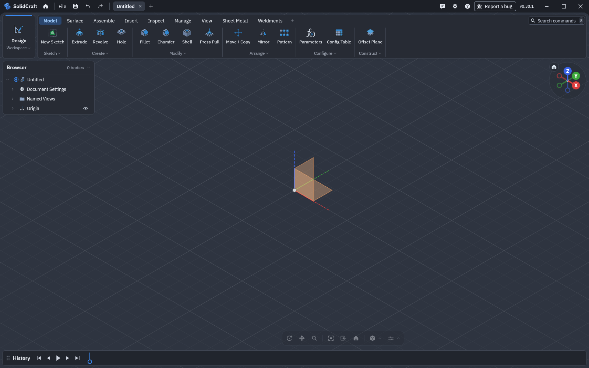 | 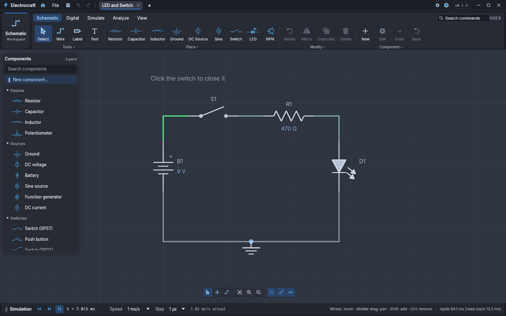 |

- **Title bar** (no OS decorations; drag to move, double-click to maximize): logo and name, Home, a **File** menu, Save, Undo and Redo icons, **one tab per open document** (name, `•` when modified, close button; click to switch, middle-click or Ctrl+W to close, Ctrl+Tab for the next; the full path on hover), and `+`, a menu that opens a new schematic, a file, a recent file or a sample **in a new tab**; on the right Settings, Help, a monospace version badge and the window controls.
- **Ribbon:** a **Schematic Workspace** card on the left; tabs **Schematic, Digital, Simulate, Analyze, View**; big icon buttons over a caption with a chevron, in groups separated by dividers; a **Search commands** box with a `Ctrl K` chip on the right (command palette).
  - *Schematic:* Tools (Select, Wire, Label, Text) · Place (Resistor, Capacitor, Inductor, Ground, DC Source, Sine, Switch, LED, NPN; drawn with the real symbols) · Modify (Rotate, Mirror, Duplicate, Delete) · Component (New, Edit, Enter, Back; section 9.7).
  - *Digital:* Gates (AND, OR, NOT, NAND, NOR, XOR) · Sequential (D FF, JK FF, Counter, Shift Reg) · I/O (Toggle, Clock, Probe, BCD→7, 7-Segment, 555).
  - *Simulate:* Transport (Run/Pause, Step, Reset) · Instruments (Probe, Voltmeter, Ammeter, Clear Scope) · Display (Voltage, Current, Scopes).
  - *Analyze:* DC Op Point · Analyses (Op Table, DC Sweep, Transient, AC Sweep; each dialog can add a parameter step) · SPICE (Import, Export) · Models (Datasheet Fit, JS Components).

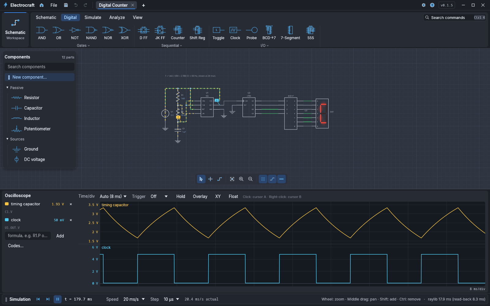
  - *View:* Navigate (Fit, Zoom in/out, Pan) · Show (Grid, Voltage, Current) · Panels.
- **Components panel** (floating card top-left, where SolidCraft has its Browser): searchable, grouped by category, each row with a symbol thumbnail; clicking arms placement.
- **Inspector** (floating card top-right, shown for a selection): name, parameters with units in engineering notation (red while unreadable), enum pickers, live controls (wiper slider, switch toggle), live probe values, **Edit Component…** and **Enter** (9.7), description, and a **Scope** section: the part's or net's code and a checkbox per quantity (9.5).
- **Navigation toolbar** (floating, bottom centre of the canvas): Select, Pan, Wire · Fit, Zoom in, Zoom out · Grid, Voltage colours, Current dots.
- **Simulation bar** (bottom, in the place of SolidCraft's History bar): Reset, Step, Run/Pause, simulated time, speed and time step pickers, achieved speed, a problems button, and on the right the tool hint (Wirecraft style) and canvas render timing.
- **Scope** (9.5): docked at the bottom above the Simulation bar (resizable), or floating in its own resizable window, whenever it has channels.
- **Settings** (gear icon, `app.settings`): current dot speed (logarithmic slider, `view.dot_speed`), current dots, voltage colours and grid; kept in `settings.json` in the config folder, as are the ribbon toggles. 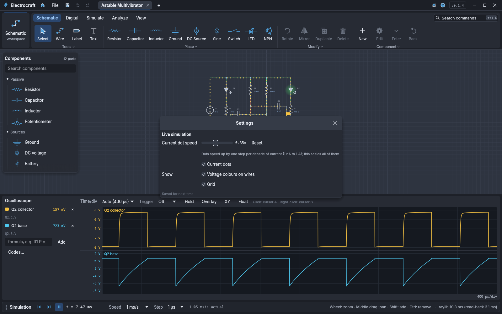
- **Documents and tabs:** New, Open, recent files and samples always open a new tab; opening a file that is already open switches to its tab. Each tab keeps its own document, undo history, selection, view, scope channels and settings, and component-editing stack. Only the shown tab simulates: switching restarts that tab's simulation from its operating point. Closing a modified tab asks Save / Discard / Cancel; quitting lists every modified document and offers **Save All**. Closing the last tab returns to the Start screen. (`DocTab` in `crates/ecs-app/src/app.rs`; a test opens, edits, switches, closes and reopens tabs.)
- **Start screen** (Home, Esc returns to the document): blue sidebar (Back to document, Start, New, Open, Save, Save As, Export netlist, Keyboard shortcuts, About), and New cards, Recent files and Samples with live-rendered thumbnails.
- **Command palette** (`Ctrl+K`): every command and every component, filtered as you type, arrow keys and Enter.

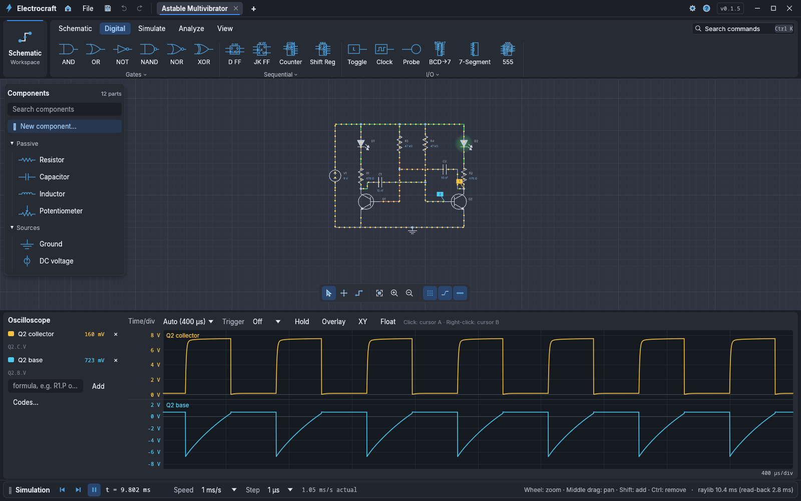

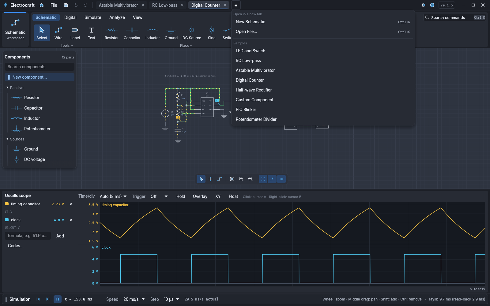

**Palette tokens** (sampled from SolidCraft 0.30.1; `crates/ecs-app/src/theme.rs`): title bar `#1C1F26`, canvas `#2E3440`, panels and ribbon `#272B34`, bottom bar `#21252D`, navigation toolbar `#2B303B`, document tab `#353B47`, active tab `#2A466E` with text `#9BC5F3`, accent `#3A88EE`, icon blue `#4EA1DC`, text `#E6EAF2`, Start sidebar `#1E5080` (selected `#2E6395`), Start background `#1F232B`, selected card `#1B3048`. Type: Inter (Regular, SemiBold) and Noto Sans Mono for shortcuts and numbers, embedded (SIL OFL).

### 9.2 Canvas integration

- Raylib renders on its own thread (3, D3) into a `RenderTexture2D` of twice the canvas size in physical pixels (respecting DPI), downsampled 2×2 into a second texture, read back and uploaded into an egui texture.
- The UI rebuilds the display list every frame and submits it only when it changed: an edit, a pan or zoom, a hover change, a pointer-following overlay, or new simulation state while running.
- egui forwards pointer and keyboard input over the canvas rect. The app converts it to schematic coordinates and feeds it to the active tool.
- **Measured read-back cost** (phase P3 requirement): the Simulation bar shows draw and read-back time. In a private Xvfb display with Mesa llvmpipe (software OpenGL), a canvas of about 1600×800 takes 8 to 15 ms to read back and 25 to 45 ms in total; about 1280×480 takes 3 ms to read back and 11 ms in total. Hardware OpenGL numbers at 1080p and 1440p are still to be recorded on the owner's machine (Q2).

### 9.3 Editing and canvas operation (Wirecraft conventions, D11)

| Input | Action |
| --- | --- |
| Wheel | Zoom at the pointer (factor `exp(0.004·Δ)`, 10% to 800%) |
| Middle drag, Space + drag, or the Pan tool (H) | Pan |
| Click an item | Select it; Shift+click adds, Ctrl+click removes (idempotent) |
| Drag a selected item | Move after a 3 px threshold, snapped to the 20-unit grid; previewed live (wires stretch) and committed as one undo step on release |
| Drag on empty canvas, left to right | Window selection: blue, solid; selects items entirely inside |
| Drag on empty canvas, right to left | Crossing selection: green, dashed; selects anything it touches |
| Right click | Context menu: Rotate, Mirror, Duplicate, Copy, Delete, Paste, the common parts, Wire, Net label, Probe, Fit |
| Click a switch or push button while running | Operate it (iCircuit feel); a push button is closed while held |
| Esc | Cancel the wire or gesture, then return to Select, then clear the selection; on the Start screen, back to the document |
| W, L, T, P | Wire, net label, text, probe tools |
| R, M | Rotate a quarter turn, mirror (also while placing) |
| `/` | Flip the wire elbow (horizontal-first or vertical-first) |
| Del, Backspace | Delete |
| Ctrl+C, Ctrl+X, Ctrl+V, Ctrl+D, Ctrl+A | Copy, cut, paste at the pointer, duplicate, select all |
| Ctrl+Z, Ctrl+Y / Ctrl+Shift+Z | Undo, redo |
| F, G, + / − | Fit, grid, zoom |
| F5, F6, F7 | Run/pause, step, reset |
| Ctrl+K, Ctrl+N, Ctrl+O, Ctrl+S, Ctrl+Shift+S | Palette, new, open, save, save as |

| Crossing selection (right to left) | Placement shadow follows the pointer |
| --- | --- |
| 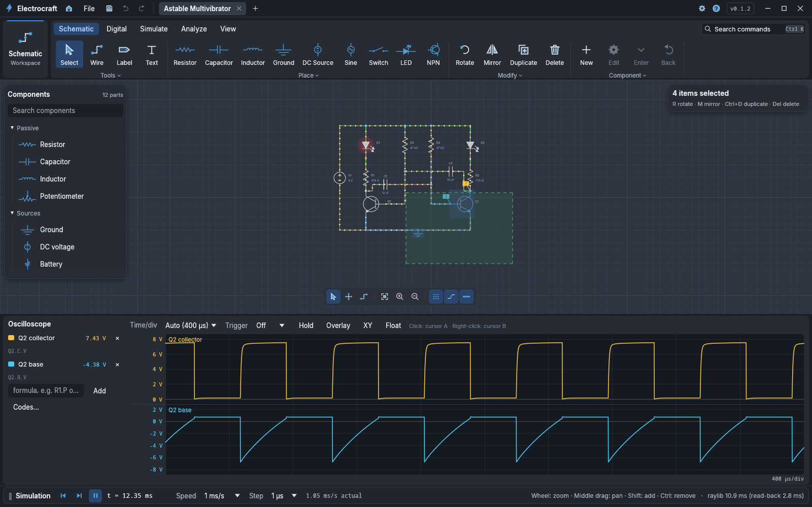 | 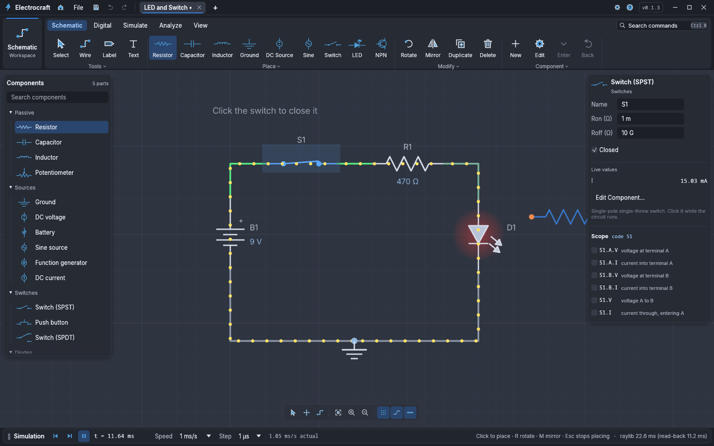 |
| **Wire routing:** orthogonal preview from a pin; clicking a pin or wire finishes | **Context menu** with the part palette |
| 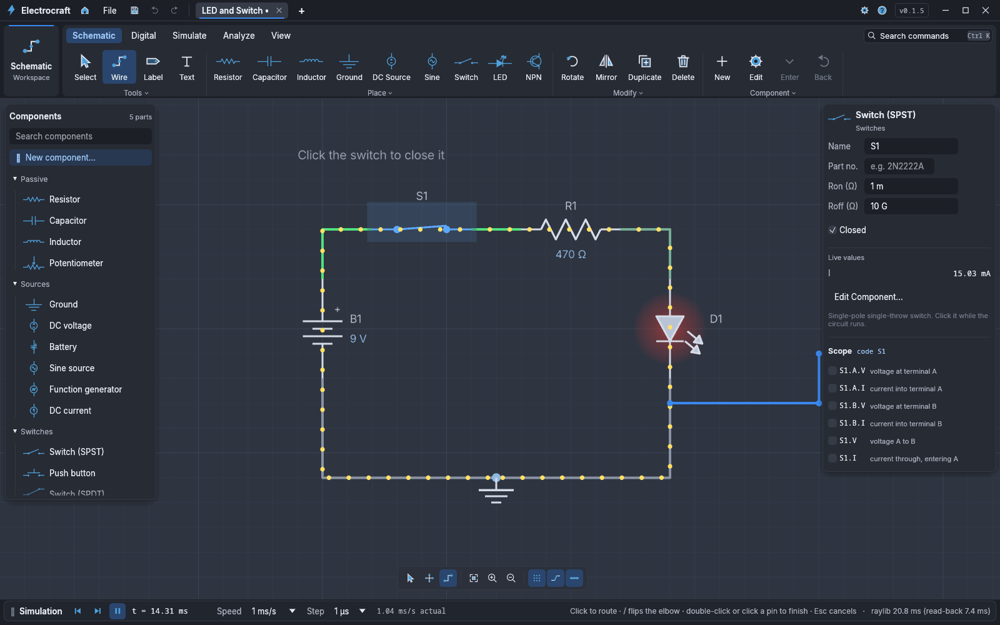 | 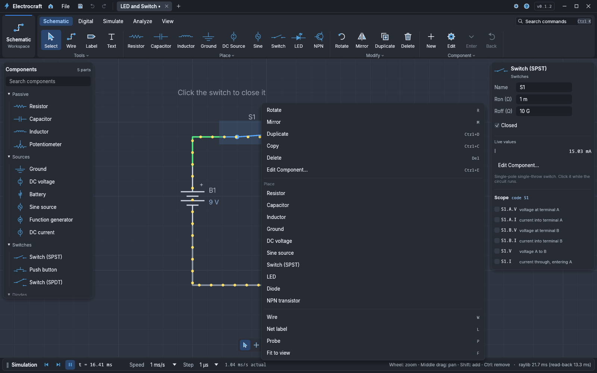 |

- Grid with snapping; place, move, rotate (R), mirror (M), delete. A placed part keeps the tool armed for the next one; Esc stops.
- Wire tool with orthogonal routing; junctions are drawn wherever three or more ends meet or an end lands on another wire's interior. Crossing wires without an end there do not connect. Wires stretch (rubber band, kept orthogonal) when parts move or rotate.
- Box and click selection, copy and paste, duplicate.
- Net labels connect by name; `GND` and `0` are ground. Text annotations.
- Undo and redo for every edit: each `Command` in `ecs-schematic` is one step, undone by restoring the document snapshot taken before it. Operating a switch or the wiper is not an edit and does not create undo steps.
- Symbols are vector primitives (lines, polylines, arcs, circles, text, pin points) on a 20-unit grid, ANSI style, with optional open and closed variants (switches) and a glow region (LED, lamp). They are defined in `ecs-schematic::symbols` and serialize to the `.sym.json` shape of section 10.

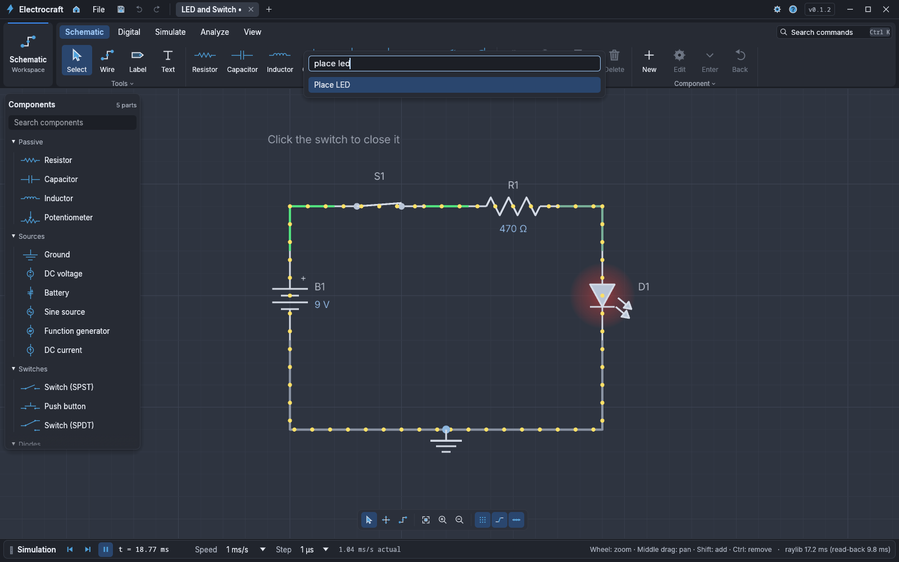

### 9.4 Live visualization (the iCircuit feel)

- **Wire colour by voltage:** a diverging scale, positive green through grey at 0 V to negative red, auto-ranged to the largest node voltage.
- **Current dots** move along wires and through two-pin parts, with speed proportional to current on a log scale (8 units/s at 1 nA, capped at 160 units/s, times the **current dot speed** setting, 0.35 by default, 0.05 to 4), so microamps and amps are both visible. Wire currents are solved per net on a spanning tree of the wire graph from the pin currents.
- **Part effects:** LEDs glow in their colour and lamps in warm white, in proportion to their `brightness` probe; switches and push buttons draw their state; meters print their reading.
- **Hover:** tooltip with the net voltage, or the part's voltage and every probe (current, power, brightness).
- **Problem markers:** a badge on any part flagged by the solver; markers fade after 5000 clean steps. The Simulation bar's problems button lists them with unconnected pins and compile errors.
- After **DC Op Point** (Analyze), node voltages and part currents are annotated until the next edit.

| Switch open | Switch closed: the LED lights and current flows |
| --- | --- |
|  | 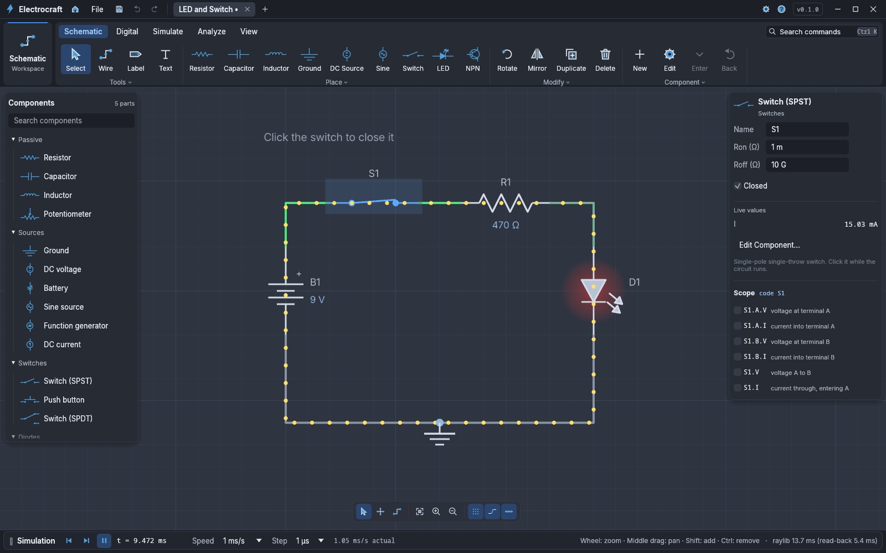 |
| **Inspector** with a live wiper slider and meter | **DC operating point** annotations |
| 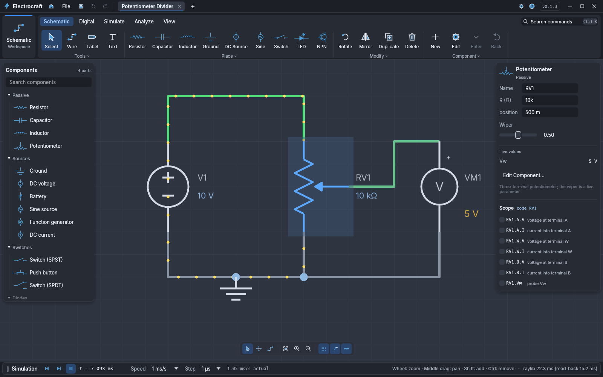 | 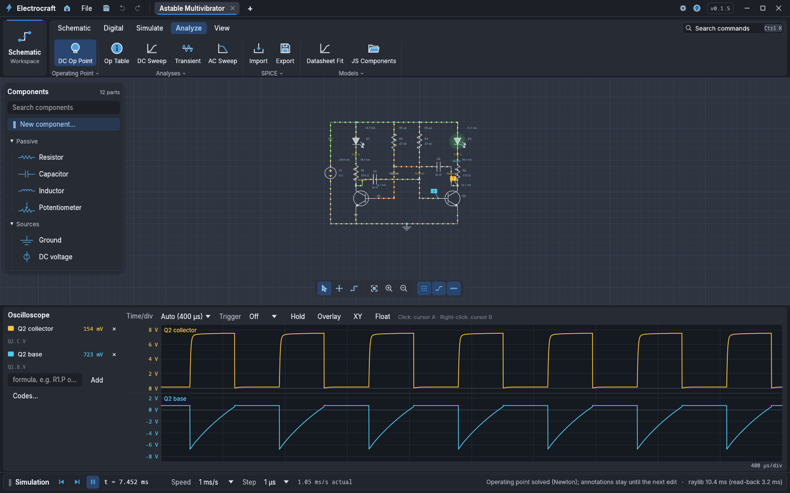 |

### 9.5 Scopes and plots

- **Oscilloscope (live, D15):** not a part. Select a wire or a part and tick quantities under **Scope** in the inspector; click with the Probe tool (P: a wire adds its net, a part its current, or its voltage when it has no current); or type a **formula** in the scope legend. Every net and part has a code distinct from its internal id: nets use their label or a stable `n<wire id>` (`p<part>_<pin>` when no wire touches them), parts their reference. Codes are variables in formulas: `out`, `in - out`, `R1.I * R1.V`, `Q1.C.I / Q1.B.I`, `D1.P`, and `t`. Each terminal has `.V` (to ground) and `.I` (into the terminal, summed over the definition's branches and digital pins); two-terminal parts also have `.V` (first pin to second) and `.I`; probes keep their names. **Codes…** lists every code with a description. Formulas compile once into tapes over at most 64 raw signals that the simulation thread samples; errors (unknown code, too many signals) show under the channel.
- **Layout:** one **lane per channel**, each with its own Y axis labelled in engineering units on a 1-2-5 grid, so a crowded scope stays readable; **Overlay** puts every channel on one grid. **Float** detaches the scope into a resizable window (default 820 × 560) and **Dock** returns it. Controls: time/div (Auto = 4 × speed, or 1 µs to 1 s), edge trigger on channel 1 (rising or falling, level at mid-range, 10% into the screen), Hold, XY (channel 2 against channel 1), and cursors A (click) and B (right-click) with per-lane readouts, Δt and 1/Δt. Numbered badges on the canvas mark the nets and terminals being shown. Probes saved by older files become channels on load. *Still to do:* per-channel scale and offset, trigger level, currents at subcircuit ports.
- **Plot windows (analysis):** `egui_plot` windows, one per run; parameter steps overlay one trace per value. A trace picker lists every node voltage and branch current (named nets first). AC results use a Bode layout (magnitude in dB over phase, log frequency, linked axes). Click and right-click place cursors A and B with values and Δ (and 1/Δ for time). FFT turns the selected transient traces into spectra. CSV export writes every trace; PNG export saves the window.

| Scope lanes with cursors A and B | Scope checkboxes in the inspector |
| --- | --- |
| 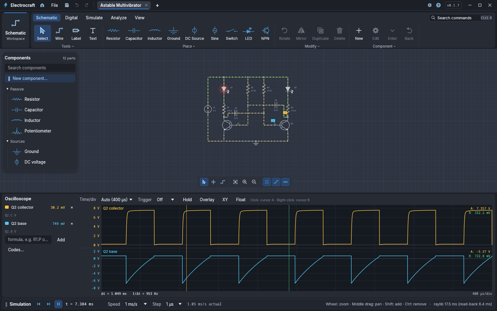 | 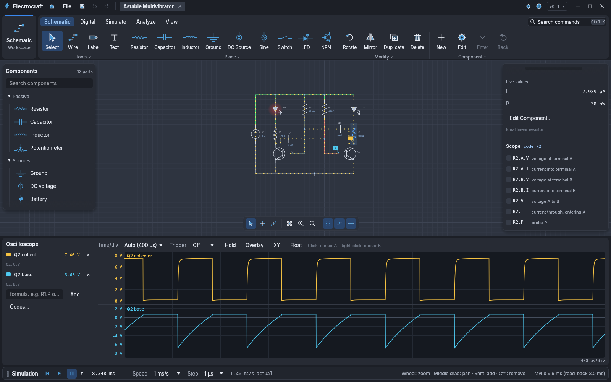 |
| **Floating scope window** | **Bode plot of the RC low-pass** |
| 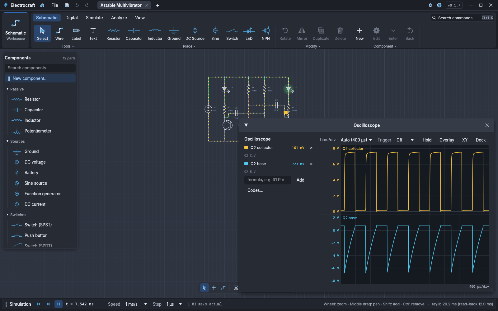 | 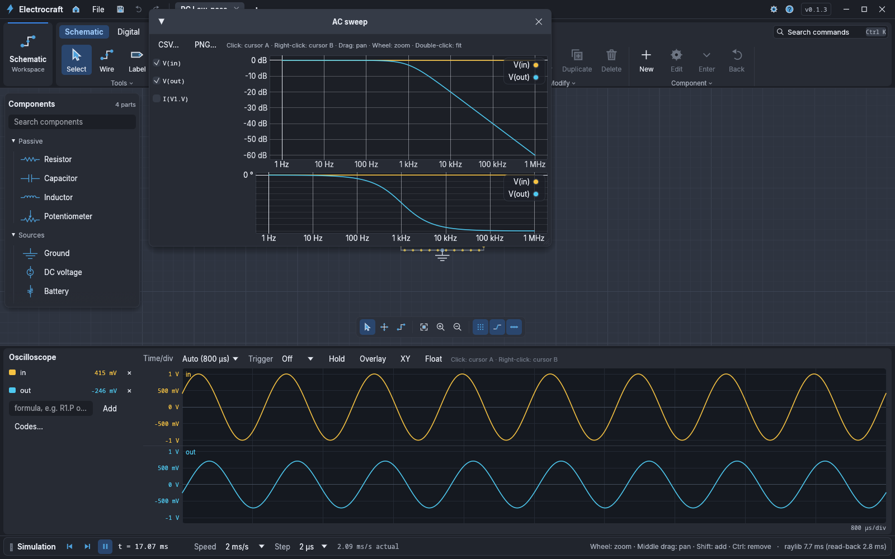 |

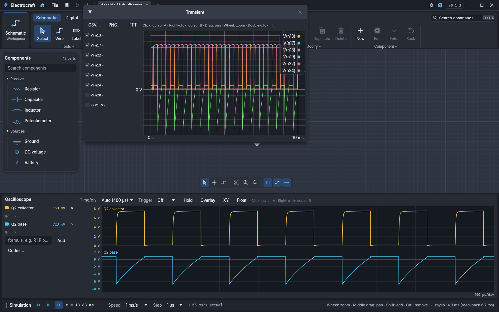

### 9.6 Commands and automation (D14, MCP-ready)

All actions are `Cmd`s with a stable id and JSON arguments in one registry (`crates/ecs-app/src/commands.rs`): `file.*` (including `file.close`, `file.switch_tab`, `file.next_tab`, `file.save_all` for tabs), `edit.*`, `schematic.place|wire|set_param|delete_part`, `scope.add|remove|clear`, `component.new|edit|enter|exit`, `tool.*`, `sim.toggle_run|step|reset|control`, `analysis.dc_op_annotate|dialog|run`, `view.*`, `app.*`. The command palette lists the registry; `electrocraft --command-catalog` prints it as JSON; `electrocraft --commands file.json` runs a list of `{"id", "args"}` at start (the screenshot script uses it). An MCP server (next step) maps one tool per registry id, queued onto the UI thread as Meshcraft does, plus read-only tools for the live snapshot and analysis results; a test checks every catalog entry builds a command.

### 9.7 Component editor and hierarchical editing (D16)

- **Edit Component…** (inspector, context menu, Schematic ▸ Component ▸ Edit, Ctrl+E) opens the prototype of the selected part. A part of a library component gets an editable copy (`local.*`); Apply points this part, or every part of that type, at the copy.
- **New** opens the editor on a blank two-pin component; Apply arms its placement.
- **Code editors** (component JavaScript, scope formulas, SPICE import; `crates/ecs-app/src/code_editor.rs`) highlight syntax: keywords, the component API, expression functions, functions and constants the file declares, parameters, pins (also inside `V("…")` strings), numbers, strings and comments, with the inside of `` e`…` `` templates coloured as the expression language. Suggestions pop up while typing and on Ctrl+Space: keywords and API, `c.` equation methods, `ctx.` hook members, `Math.` members, expression functions, declared helpers with their signatures and doc comments, parameters, `c.let` values, states, and pin names inside strings (from the file and the symbol); scope formulas suggest every net and part code with its description. Up/Down choose, Tab or Enter accept, Esc closes; Enter keeps the indentation; a line under the editor shows the signature of the call around the cursor.
- The editor window has three tabs. *General:* name, prefix, category, description, ports and parameters. *Symbol:* a canvas with a 20-unit pin grid and Select (click, drag, Delete), Line, Rect, Circle, Polyline, Text and Pin tools; **Start from** an existing symbol (replace, or add its drawing), **Box** (a box with the current pins), Clear; the pin list renames and removes pins. *Implementation:* Schematic, External schematic, JavaScript (code editor with Template) or External JavaScript (path with Browse…). **Check** compiles without applying and reports pins, parameters and problems; Apply adds the port labels for new pins to an inner schematic.
- **Enter** (Ctrl+Enter, inspector, context menu) opens a part's inner schematic on the canvas with a breadcrumb and **Back**. Port labels are created for every pin the first time. The inner schematic simulates on its own while open; Back writes it into the prototype as one undoable edit (an external file is saved instead), and every instance updates. Save while inside writes the outer document with the inner one folded in.

| Component editor: symbol | Inside a component |
| --- | --- |
| 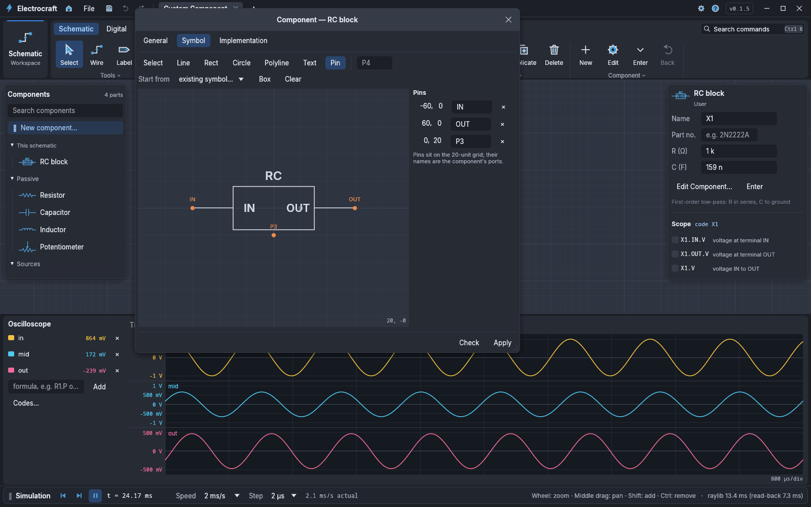 | 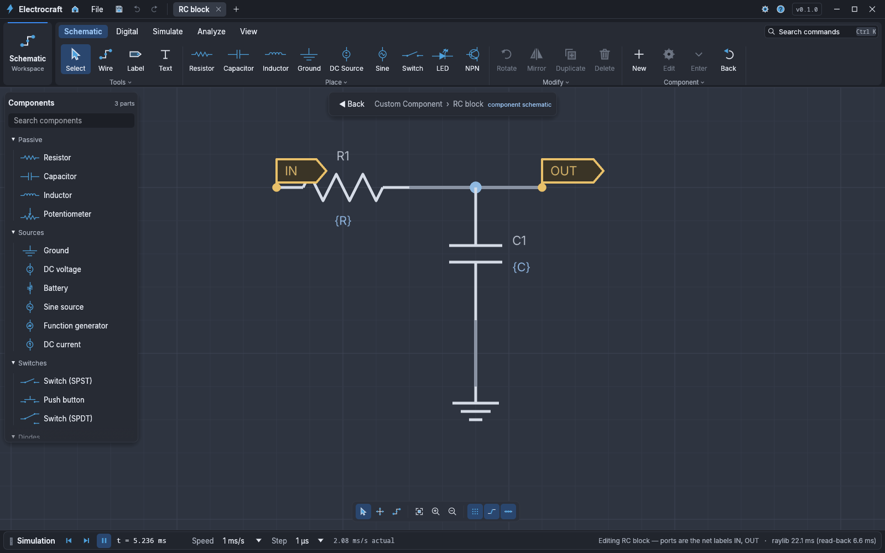 |
| **JavaScript with highlighting and suggestions** | **Scope formula suggestions** |
| 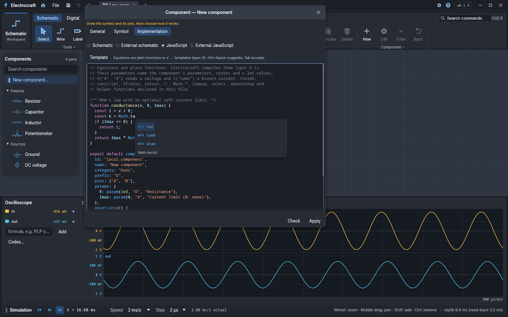 | 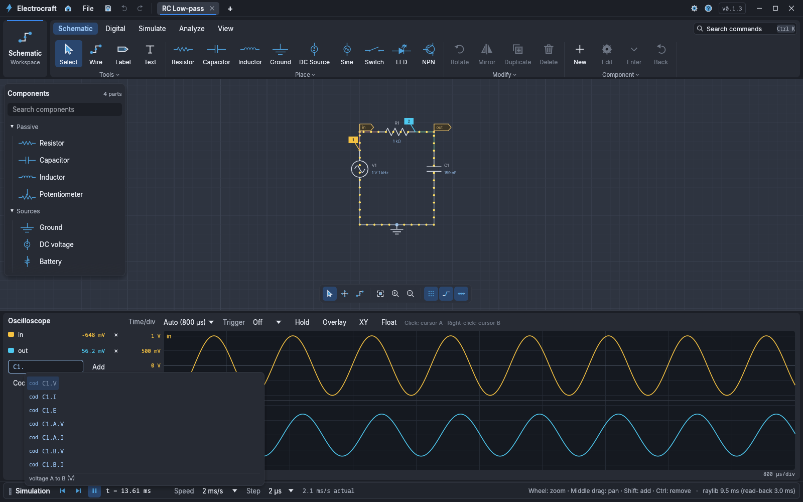 |

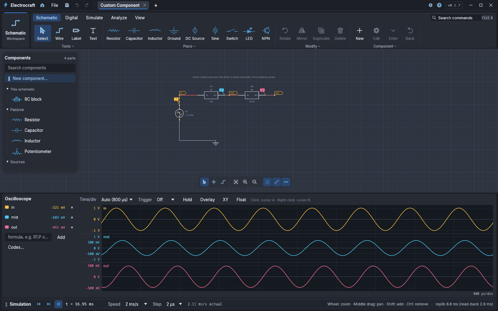

## 10. File formats

All native files are pretty-printed JSON (serde) with a `format_version` field and stable key order, so they diff cleanly in git and other tools can read them. Loaders migrate older versions forward.

| File | Extension | Contents |
| --- | --- | --- |
| Schematic | `.ecs` | Metadata; component instances (unique id, definition id and version, package, symbol, position, rotation, mirror, parameter overrides as typed, saved control states, reference label like R1); wires as polylines; net labels; text; scope channels (`scope`: name and formula; older `probes` migrate to channels); component prototypes (`components`: id, name, category, prefix, description, symbol, parameters, and an implementation tagged `schematic`, `external_schematic`, `script` or `external_script`); simulation settings (speed, time step); saved analysis presets (P7). Junctions are derived from the wires, not stored. |
| Symbol | `.sym.json` | Vector primitives, pin points with names and directions, label anchors, bounding box |
| Component package | folder, or `.ecspkg` (zip) | `package.json` manifest (format version, name, version, author, license, `models` (original SPICE files) and `components` (id, chosen symbol, port-to-pin names)); `.js` component files; `symbols/`; `models/` with the original SPICE files; `docs/`. *Implemented:* folders with `package.json` and `models/`; zipped packages and `symbols/` are still to do. |
| Analysis result | `.ecsr` | Analysis command and settings, then named vectors (time or frequency axis plus signals). Binary payload with a JSON header, for size. *Not yet:* results export as CSV. |

**Exports:** SPICE netlist (to cross-check a circuit in ngspice), CSV of any plot or scope, PNG of the canvas. SVG export of the schematic comes later. *Implemented:* SPICE netlist, CSV and PNG of plot windows.

**Compatibility rule:** a schematic stores the version of each component definition it used. If a newer version is installed, the app offers to update, and keeps the old behavior until the user accepts.

## 11. Testing & validation

The simulator is checked against math first, then against ngspice. Every phase in section 12 ends with its tests green in CI.

*Implemented in 0.1.0:* autodiff property tests against finite differences, plus folding/CSE against a naive tree walk (`ecs-expr/tests/autodiff.rs`); analytic circuits within 0.1% (divider, Wheatstone, RC charge, RL rise, series RLC ringing period, RC low-pass gain at the corner, diode operating point against bisection) plus an astable multivibrator and loop/floating-node checks (`ecs-sim/tests/analytic.rs`); schematic commands headless (rotation, netlist of a divider, T junctions and crossings, labels, undo/redo, rubber-band wires, rotation keeping connections, window and crossing selection, byte-identical save/load/save); every sample circuit fully connected and simulating, the astable running 30 ms with no convergence flags, the LED lighting when its switch closes; release helpers (AppImage name, update information, desktop keys AppGlider reads). Phases P5 to P8 added: gate truth tables, start-up settling, a D flip-flop dividing a clock, a 555-clocked counter driving a decoder and display at the expected 686 Hz (`ecs-sim/tests/digital.rs`); subcircuit flattening and cross-element currents; AC corner (−3 dB, −45°), DC sweeps (live and recompiled), adaptive transient steady state, parallel parameter step and FFT (`tests/analyses.rs`); the 6.2 examples loading and simulating, sandbox escapes (`eval`, the `Function`, async-function constructors, `require`, `std`, `os`, `fetch`, `setTimeout`), runaway hooks and loads stopped, template errors on the right line (`ecs-script/tests/scripts.rs`); SPICE import of a transistor model against hand analysis, an op-amp subcircuit in an active low-pass against the closed-form Bode response, B and F sources, export round trip, and an ngspice comparison that runs when ngspice is installed (CI installs it) (`ecs-spice/tests/import.rs`); diode and NPN fits from 1N4148 and 2N3904 typicals within 5% and a MOSFET fit (`datasheet-tool`); every definition's pins on its symbol, the counter sample counting, and every registry command building (`ecs-app`). 89 tests in all (0.1.4 added live values surviving parameter edits; 0.1.3 added document tabs; 0.1.1 added scope code resolution, schematic-defined components and the library-to-JavaScript round trip; 0.1.2 equation functions, the function diode against the template diode, Newton acceptance on exponentials, and the code editor's declarations, completion contexts and highlighting), plus the release-script unit tests. Not yet: the full ngspice corpus, the convergence torture set, criterion benchmarks, renderer snapshot tests.

- **Expression engine:** property tests (`proptest`) comparing autodiff derivatives with finite differences over random expressions and inputs; constant folding and CSE must not change results.
- **Analytic circuits:** results within 0.1% of closed-form answers: voltage divider, RC charge and discharge, RL, series RLC ringing frequency and damping, RC low-pass corner frequency in AC, Wheatstone bridge.
- **ngspice golden corpus:** about 50 netlists run through `ecs-cli` and ngspice in CI. Waveforms are resampled to a common time base. Analysis mode must match within 1% of the signal's range; Interactive mode within 5%.
- **Convergence torture set:** Schmitt trigger, latch, ring oscillator, bridge rectifier with a large reservoir capacitor, flyback converter, op-amp at its rails. DC OP must converge and transient must finish without aborts.
- **Digital:** truth tables for every gate, flip-flop timing, a 4-bit counter driven by a 555 clock, mixed-signal threshold crossing.
- **Performance (`criterion`):** steps per second on reference circuits, tracked per commit. Initial target to revise after phase 2: a 50-component mixed circuit runs real time at a 5 µs step on a mid-range desktop CPU.
- **Scripting:** sandbox escape attempts (file or network access, `eval`, the `Function` constructor) fail; runaway hooks are stopped by the time budget; hot reload keeps the app running after a broken script; `e` template parse errors point to the right file, line and column.
- **Editor:** `ecs-schematic` commands tested headless (place, wire, junction creation, undo and redo, netlist extraction). Renderer snapshot tests compare off-screen PNGs of every symbol.
- **Files:** save, load and save again gives identical bytes; older format versions load through migrations.

## 12. Implementation plan

The work is split into nine phases. The engine (P1, P2) and the editor (P3) proceed in parallel and meet in P4, the first version that feels like iCircuit. v1 is P0 to P7; the datasheet tool follows.

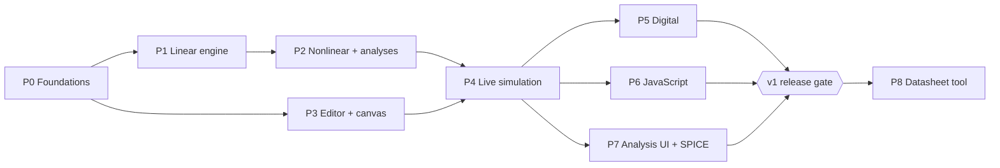

**Status at 0.1.4** (Nov 10, 2026):

| Phase | Status | Done | Remaining |
| --- | --- | --- | --- |
| P0 | Done | Workspace with every crate; `ecs-units`, `ecs-expr` (parser, folding, CSE, autodiff tapes, linearity), `ecs-model`; CI workflow | — |
| P1 | Mostly done | Netlist compiler, topology checks, MNA from tapes, `LinearSolver` + dense LU, BE and trapezoidal, linear fast path via factor reuse, `electrocraft-cli` (the full SPICE importer and every analysis card) | `faer` sparse LU and benchmark; PWL and pulse breakpoints |
| P2 | Mostly done | Newton with pn limiting, gmin, residual test; DC OP with gmin and source stepping; error-controlled transient, AC, DC sweep, parameter step; diodes, BJTs, MOSFETs, JFETs, op-amp, comparator, switches, lamp | Step rejection with a true LTE estimate, Gear-2, relay, fuse, ngspice corpus, torture set |
| P3 | Mostly done | eframe glow shell (D10), Raylib off-screen canvas on its own thread with read-back timing, ANSI symbols for every built-in, editing (D11), undo/redo, netlist extraction, `.ecs` save/load, samples | Hardware read-back numbers at 1080p/1440p; `.sym.json` files on disk; renderer snapshot tests |
| P4 | Done | Simulation thread, command channel, triple-buffered snapshots, SPSC scope ring, pacing within a 60% CPU budget, step halving, damped integration, non-fatal failure with markers, live controls, reset; wire colours, current dots, glows, lit segments, hover, problems list; formula scope (D15) with lanes, overlay, floating window, trigger, hold, XY, cursors and inspector checkboxes | Per-channel scale and offset; currents at subcircuit ports |
| P5 | Done | Event layer, logic families with hysteresis, Thevenin ramped outputs, watches, tri-state, settling; 21 digital and mixed-signal parts; Digital ribbon tab; counter sample | Pure event-domain digital nets (optimization) |
| P6 | Done | QuickJS host, full 6.1 API, sandbox and limits, per-thread runtimes, hot reload, problems, `.d.ts`, reference components; equations as plain functions compiled to expressions; highlighted code editor with suggestions | ES `import` inside packages; a user guide page |
| P7 | Done | Analysis dialogs, background jobs with progress and cancel, plot windows (Bode, cursors, FFT, CSV, PNG), DC Op annotation; SPICE import (models, subcircuits, B/E/F/G/H, includes) with symbol and pin mapping into packages; SPICE export | `.ecsr` result files; `.ecspkg` zip packages; linear and octave sweeps |
| P3+ | Done | Components in a schematic (D16): component editor with symbol drawing, nested and external schematics, inline and external JavaScript, editable copies of library parts, enter/back editing, parameter expressions in subcircuits; custom component sample | Nested prototypes inside inner schematics; symbol arcs and fills in the editor |
| P8 | Done | `electrocraft-datasheet`: five families, test-bench fitting with Levenberg-Marquardt, curve digitizer, review overlay, JS and report export into the components folder | Op-amp macromodel and regulator families; reading tables from PDFs (Q5) |

P5, P6 and P7 depend only on P4 and can run in any order or in parallel.

**Rules for the coding agent**

- Follow the decision log (section 2). Never add a dependency on WGPU, directly or through a crate's default features.
- Keep crate boundaries from section 3: `ecs-sim` and below must build and test with no UI crates.
- Every phase ends with its acceptance tests passing in CI: `cargo fmt --all --check`, `cargo clippy --workspace --all-targets --locked -- -D warnings`, `cargo test --workspace --locked`, plus the phase's own checks.
- UI changes come with refreshed screenshots: `python3 scripts/capture_screenshots.py` drives the release binary in a private Xvfb display and rewrites `docs/screenshots/`.
- Deliver each phase as a series of small, reviewable commits. Public APIs get rustdoc comments.
- When the spec is unclear or wrong, stop and record the question rather than guessing silently.

### P0 Foundations

- Cargo workspace with all crates from section 3 as stubs; CI pipeline.
- `ecs-units`: SI values, engineering notation parse and format.
- `ecs-expr`: expression graph, constant folding, CSE, forward-mode autodiff, instruction tape and interpreter.
- `ecs-model`: `ComponentDef` and related types from section 5.3.
- **Done when:** autodiff property tests pass; a resistor and a diode can be defined in Rust and their tapes evaluated.

### P1 Linear engine (headless)

- Netlist compiler: node numbering, branch unknowns, sparsity pattern, topology checks (5.4).
- MNA assembly from tapes; `LinearSolver` trait with sparse (`faer`) and dense implementations.
- Components: resistor, capacitor, inductor, DC and AC voltage and current sources, pulse, PWL, controlled sources.
- Fixed-step transient with backward Euler and trapezoidal; linear fast path; breakpoints.
- `ecs-cli`: reads a small SPICE-like netlist, writes CSV.
- **Done when:** all linear analytic circuits in section 11 pass.

### P2 Nonlinear engine and analyses

- Newton-Raphson with limiting, gmin, convergence tests; DC operating point with gmin and source stepping.
- Variable-step transient with truncation-error control; Gear-2; AC small-signal; DC sweep; parameter step.
- Components: diodes, BJTs, MOSFETs, JFETs, op-amp models, switches, relay, fuse, lamp.
- ngspice golden corpus and convergence torture set in CI.
- **Done when:** the corpus matches ngspice within 1% and the torture set passes.

### P3 Editor and canvas (parallel with P1 and P2)

- eframe app on the glow backend; window layout from 9.1.
- Raylib off-screen canvas following Meshcraft; measure read-back cost at 1080p and 1440p and record it.
- Symbol format and ANSI symbols for every v1 component.
- `ecs-schematic`: placing, wiring, junctions, labels, selection, undo and redo, netlist extraction; `.ecs` save and load.
- **Done when:** a user can draw any section 11 test circuit, save it, reload it, and the extracted netlist matches the hand-written one.

### P4 Live simulation

- Simulation thread, command channel, triple-buffered snapshots, sample ring buffers (section 3).
- Interactive mode from 4.5: pacing, step halving, non-fatal failure with markers, live controls, reset.
- Visualization from 9.4: wire colors, current dots, part effects, hover tooltips; scopes from 9.5.
- **Done when:** an astable multivibrator, an RC filter driven by a function generator, and a bridge rectifier run live at real time with smooth animation, and switching a switch takes effect within one frame.

### P5 Digital and mixed-signal

- Event queue, logic families, digital pins coupled to analog (4.7).
- Digital components and I/O from section 7; 555 timer.
- **Done when:** a 555-clocked 4-bit counter driving a 7-segment display runs live and matches expected timing.

### P6 JavaScript scripting

- `ecs-script` with the API from 6.1, sandbox and limits from 6.3, hot reload, problems panel.
- Reference JavaScript components, the .d.ts API declarations, and a short user guide.
- **Done when:** the two examples in 6.2 load, simulate correctly, and sandbox tests pass.

### P7 Analysis UI and SPICE import

- Analysis commands in the UI with settings dialogs; plot windows with Bode layout, cursors, FFT, CSV and PNG export; operating point annotation.
- `ecs-spice` import with mapping, symbol selection and report (8.1); SPICE netlist export.
- **Done when:** a vendor op-amp `.subckt` and a transistor `.model` import and reproduce ngspice results; a Bode plot of an active filter matches ngspice.

### P8 Datasheet tool (after v1)

- Separate app implementing 8.2: forms per family, curve digitizer, fitter, overlay review, JavaScript export.
- **Done when:** a diode and an NPN transistor fitted from their datasheets reproduce the datasheet points within 5%.

## 13. Packaging and distribution (D12)

Releases follow Meshcraft: a manual workflow (`.github/workflows/release.yaml`) runs at an existing tag equal to the literal `version` in `crates/ecs-app/Cargo.toml`, with no `v` prefix (`0.1.0`), validates (fmt, clippy, tests), builds every target in parallel and publishes one release with per-file SHA-256 sidecars and `SHA256SUMS.txt`. The target matrix is Meshcraft's six native targets; packaging helpers are standard-library Python in `scripts/release/` with unit tests.

| Target | Artifacts | Status |
| --- | --- | --- |
| Linux x86_64 / aarch64 | AppImage (+ `.zsync`), portable `tar.gz` | Scripted and verified locally on x86_64 |
| Linux | Snap (`core24`, `mesa-2404` GPU content, strict, `grade: stable`), DEB, RPM | Snap `electrocraft_X.Y.Z_<amd64|arm64>.snap` built in the release workflow by `scripts/release/snap.py`: the three binaries (apps `electrocraft`, `electrocraft.cli`, `electrocraft.datasheet`), the windowing libraries that neither core24 nor mesa-2404 provide (Xcursor, Xrandr, Xi, Xinerama, Xrender, xkbcommon-x11, xcb-xkb, with their dependencies) and the XKB data; the job installs it with core24 and mesa-2404, checks `--version`, and runs the app under Xvfb (still running after 15 s, a painted screenshot). Store upload is not automated. DEB and RPM still to port from Meshcraft |
| Windows x64 / ARM64 | Portable `zip`; MSI; MSIX with the reserved Store identity (`packaging/windows/store-identity.json`: `K3D0.electrocraft`) | Portable zip in the workflow (the app links with `/FORCE:MULTIPLE` because raylib and user32 both export `CloseWindow` and `ShowCursor`; see `crates/ecs-app/build.rs`); MSI and MSIX still to port |
| macOS Intel / Apple Silicon | Portable `zip`; DMG | Portable zip in the workflow; DMG still to port |

**AppGlider compatibility.** AppGlider installs from GitHub releases and reads each AppImage's own files. Electrocraft releases are shaped to its rules (checked by `scripts/release/appimage.py` after every build and by `test_release.py`):

- **Asset name:** `electrocraft-X.Y.Z-linux-<arch>.AppImage`, the first of AppGlider's preferred patterns (`<stem>-<version>-linux-<arch>.AppImage`, as SolidCraft uses). Meshcraft's `meshcraft-X.Y.Z-<arch>.AppImage` only matches the third. Exactly one AppImage per architecture per release, so AppGlider never has to ask which build to install.
- **Embedded desktop entry** (`packaging/linux/electrocraft.desktop`): AppGlider keeps `Comment`, `Categories`, `MimeType`, `Keywords`, `StartupWMClass`, `StartupNotify`, `Terminal`, `Exec` and `Actions`, and reads `Name`, `Icon` and `X-AppImage-Version` for the app's identity. All are present. `X-AppImage-Version` is filled at build time, `StartupWMClass=electrocraft` equals the window's app id (`APP_ID` in `main.rs`, checked by a test), and the `new-schematic` action runs `electrocraft --new`.
- **Icon:** `Icon=electrocraft`, with `electrocraft.png` (512 px) at the AppImage root and as `.DirIcon`, which is where AppGlider looks. The repository icon is named after the project (`packaging/electrocraft.png`, `assets/branding/electrocraft.svg`), which AppGlider's icon discovery ranks first.
- **Update information:** `gh-releases-zsync|alfu32|electrocraft|latest|electrocraft-*-linux-<arch>.AppImage.zsync` is embedded and the `.zsync` is published, so AppImageUpdate works too.
- **Runtime:** the type 2 runtime and appimagetool are pinned by SHA-256 (`packaging/appimage-inputs.json`, Meshcraft's pins), with their licence notices shipped inside the AppImage. The AppImage runs without FUSE via `APPIMAGE_EXTRACT_AND_RUN=1`.
- **Dependencies:** the binary links only glibc, libm and libgcc_s. GLFW (Raylib) and winit (eframe) load X11, Wayland and OpenGL at run time, so nothing else needs bundling. The glibc floor is that of the build host: Ubuntu 22.04 runners give glibc 2.35. Meshcraft's Ubuntu 18.04 container (glibc 2.27) is the target for wider reach.
- **Companion tool:** `electrocraft-datasheet` ships inside the AppImage and portable archives, reached from a second desktop action (`datasheet-tool`, which runs `electrocraft --datasheet`).
- **Desktop integration files:** AppStream metadata `io.github.alfu32.electrocraft.metainfo.xml` and the MIME type `application/x-electrocraft` for `*.ecs`.

## 14. Open questions

- [x] **Q1 Name:** Electrocraft (D13).
- [ ] **Q2 Canvas copy:** read-back is measured and shown live (9.2); software-GL numbers are acceptable. Record hardware numbers at 1080p and 1440p before deciding on sharing one OpenGL context with egui.
- [ ] **Q3 Platforms:** Windows and Linux for sure? macOS too? (OpenGL is deprecated on macOS but still works.) The release workflow builds all three.
- [ ] **Q4 License:** open source or closed? The crates and AppStream metadata currently say `MIT OR Apache-2.0`, like Meshcraft and Wirecraft, but no licence files are committed until the owner decides.
- [ ] **Q5 Datasheet extraction:** should the datasheet tool also read tables straight from PDFs, possibly with AI assistance, or stay with manual entry and curve digitizing?
- [ ] **Q6 Store listings:** the Microsoft Store identity and the Snap name are reserved (`packaging/msstore`, `packaging/snapstore`, git-ignored). Which store submissions should the next release include?
