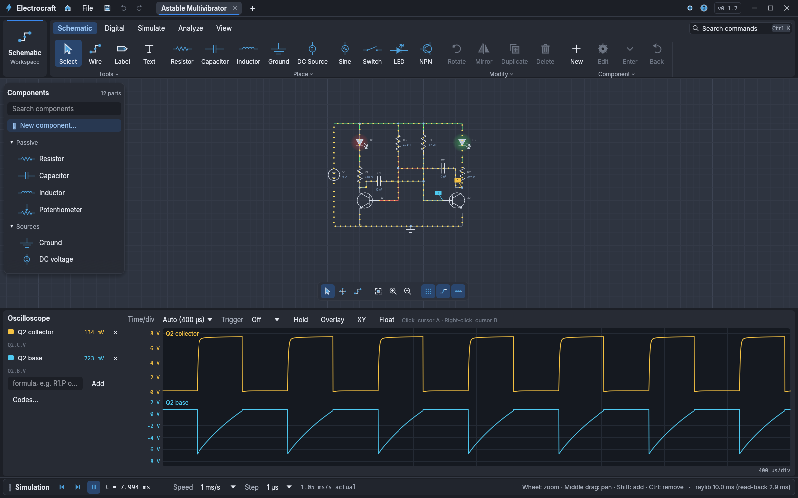

# Electrocraft

Draw electronic schematics and simulate them live: place parts, wire them, and
watch voltages, currents and waveforms change while you flip switches and turn
knobs. Wires are coloured by voltage, dots show current, LEDs glow.



It covers analog and digital parts (gates, flip-flops, counters, a 555, a
7-segment display), 75 standard 74xx and 4000-series logic chips, PIC
microcontrollers (PIC16, PIC24, PIC32) programmed in assembly in a highlighted
editor, part numbers that apply real device models (2N2222A, 1N4148, 74HC00…), an oscilloscope whose channels are formulas over net and
part codes (`out`, `R1.I`, `Q1.C.V * Q1.C.I`; tick them in the inspector, one
lane per channel, docked or floating), your own components with a drawn symbol
implemented by a nested schematic or JavaScript (edit any part's component, or
enter its schematic; equations as plain JavaScript functions or `e` templates,
in an editor with highlighting and suggestions), DC sweep, transient, AC (Bode) and parameter-step
analyses with plots, SPICE model and subcircuit import, online part catalogs
(JLCPCB/LCSC, DigiKey, Mouser, TME, Farnell: search, place real parts with
their values, keep a preferred vendor per part and export a bill of materials;
off until you enable a provider in Settings, keys kept in the system keychain),
and a companion tool that fits models to datasheet curves.

Electrocraft is a native Rust app: an egui shell in SolidCraft's visual
language, a Raylib off-screen canvas operated like Wirecraft's, and a modified
nodal analysis engine whose components are plain expressions compiled to
autodiff tapes. The full specification and plan, with screenshots and the
implementation status of each phase, is in
[ELECTROCRAFT-PLAN.SPEC.md](ELECTROCRAFT-PLAN.SPEC.md).

## Run

```sh
cargo run --release                      # Start screen
cargo run --release -- --sample astable  # led-switch, rc-lowpass, astable, counter, rectifier, rc-blocks, pic-blink, divider
cargo run --release -- circuit.ecs
cargo run --release -- --software-canvas # draw the canvas with egui instead of Raylib
cargo run --release -- --command-catalog # every command id (the future MCP tools)
cargo run --release -- --sample rc-lowpass --commands run-ac.json   # [{"id": "analysis.run", "args": {"kind": "ac"}}]
cargo run --release -p datasheet-tool -- --example npn             # datasheet model fitting
```

Samples: `led-switch`, `rc-lowpass`, `astable`, `counter`, `rectifier`, `divider`.
User JavaScript components go in `~/.config/electrocraft/components/` and reload
when saved; imported SPICE packages live in `~/.config/electrocraft/packages/`.

Building needs a C toolchain, CMake 3.25 or newer and clang (Raylib), plus the
X11/Wayland/OpenGL development headers on Linux.

Headless runner:

```sh
cargo run --release -p ecs-cli -- examples/rc.cir   # runs the netlist's .op/.dc/.tran/.ac cards, prints CSV
```

## Checks

```sh
cargo fmt --all --check
cargo clippy --workspace --all-targets --locked -- -D warnings
cargo test --workspace --locked
python3 -m unittest discover -s scripts/release -p 'test_*.py'
python3 scripts/capture_screenshots.py      # refresh docs/screenshots (Xvfb, xdotool, ImageMagick)
```

## Packaging

```sh
cargo build --release --locked -p ecs-app -p ecs-cli -p datasheet-tool
python3 scripts/release/appimage.py        # dist/electrocraft-X.Y.Z-linux-<arch>.AppImage + .zsync
python3 scripts/release/snap.py            # dist/electrocraft_X.Y.Z_<arch>.snap (core24, strict, mesa-2404)
python3 scripts/release/portable.py --target x86_64-unknown-linux-gnu
```

AppImages are named and described the way AppGlider expects; see section 13
of the specification. Releases run from `.github/workflows/release.yaml` at a
tag equal to the app version (`0.1.0`, no `v`).
